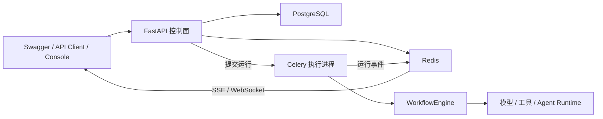

# Weora 工程协作指南

本文档约束参与 Weora 开发的人类和编码智能体。目标是让新增代码遵守一致的领域边界、依赖方向和工程标准，同时避免为了“看起来像 DDD”引入不必要的抽象。

## 1. 项目定位

Weora 是面向企业内部场景的 Human-Agent 协作与智能体编排平台。它不要求所有人改用同一种 Agent，而是在不同模型、平台和 Agent Runtime 之间建立统一的组织资产与协作层。

核心目标包括：

- 统一接入企业采购的模型，以及 Codex、Claude Code、开源 Agent 等不同 Runtime。
- 将 Agent、Skill、工作流、知识库和工具沉淀为可版本化、可发布、可分发的组织资产。
- 为企业提供工作空间、权限、密钥、审计和可观测能力。
- 降低非技术岗位获取和使用团队 Skill、小工具的门槛。
- 让人类能够在 Agent 运行过程中审批、纠偏、暂停和恢复。
- 支持多智能体项目协作、A2A，以及 Codex、Claude Code 等本地 Coding Agent Runtime。

Weora 不是一次性 Demo，也不是 Dify 或 Coze Studio 的换皮实现。它不以替代所有现有 Agent 工具为目标，而是解决模型接入、资产复用、团队协作和企业治理问题。上游项目只用于研究产品能力、领域模型和工程取舍。

## 2. 事实来源

开发前先区分三类信息：

1. **产品事实**：来自 Weora 自己的产品、架构和 ADR 文档。
2. **实现事实**：来自当前代码、数据库迁移、接口契约和自动化测试。
3. **参考事实**：来自 Dify、Coze Studio、Graphon 等上游项目。

参考事实不能直接替代产品决策。发现文档与代码不一致时：

- 描述当前行为，以代码和可执行测试为准。
- 判断预期行为，以 Weora 产品文档和已批准 ADR 为准。
- 不根据上游项目的实现，擅自改变 Weora 的产品边界。

## 3. 技术基线

在新的 ADR 作出替代决策前，后端采用以下技术基线：

| 领域 | 技术选择 |
| --- | --- |
| Python | Python 3.12 |
| 项目与依赖管理 | uv、`pyproject.toml`、`uv.lock` |
| API | FastAPI、Pydantic v2 |
| 数据库 | PostgreSQL、SQLAlchemy 2、Alembic |
| 缓存与消息 | Redis |
| 后台任务 | Celery Worker、Celery Beat |
| 工作流执行 | 自有 `WorkflowEngine` 端口，Graphon 作为适配器 |
| 对象存储 | S3 协议，开发环境可使用 MinIO |
| 可观测性 | 结构化日志、OpenTelemetry |
| 测试 | pytest、HTTPX、Testcontainers |
| 本地部署 | Docker Compose |

不要仅为了追随上游版本而升级依赖。升级必须经过兼容性检查、测试和 ADR 或变更说明。

## 4. 总体架构

Weora 首先采用模块化单体，通过独立进程区分控制面和执行面。不要在领域边界尚未稳定时提前拆分微服务。



- **控制面**：配置、版本、发布、权限、运行记录和查询接口。
- **执行面**：模型调用、工具调用、工作流执行、后台任务和事件上报。
- **基础设施**：数据库、Redis、对象存储、外部模型、Graphon、MCP 和 A2A。

代码可以在一个仓库内运行，但控制面和执行面不得通过进程内全局状态形成隐式耦合。

### 客户端架构

客户端使用根级 pnpm workspace，不把 Web 实现等同于全部前端：

```text
apps/
├── web/         # React DOM Web 控制台
├── desktop/     # 未来桌面端，按真实需求创建
└── mobile/      # 未来移动端，按真实需求创建
packages/        # 经真实复用证明的共享包
```

- 依赖方向只能是 `apps/* -> packages/*`，共享包不得反向依赖客户端应用。
- 所有客户端优先共享数据契约、领域行为和设计令牌。
- Web 与桌面端可以共享 React DOM 实现；移动端不强制共享 Web 页面和 CSS。
- 网络、存储、通知、文件系统等平台能力由各应用自己的适配器实现。
- 当前只有一个客户端时，不提前创建空 SDK、通用 UI 或只有一个实现的平台接口。
- 跨端边界的完整决策见 `docs/adr/0001-client-monorepo-and-sharing-boundaries.md`。

## 5. 领域模块

规划中的主要业务模块如下：

```text
src/weora/
├── identity/          # 用户、工作空间、成员和权限
├── agents/            # Agent 草稿、版本、发布和配置
├── skills/            # Skill 包、版本、兼容目标、发布和分发
├── workflows/         # 工作流定义、版本、发布和执行入口
├── knowledge/         # 数据集、文档、切片、索引和检索
├── tools/             # Tool、插件、MCP 和调用策略
├── runs/              # 运行、步骤、事件、轨迹、成本和恢复
├── collaboration/     # Human-Agent 协作室、任务、审批和产物
├── interoperability/  # A2A、本地 Worker 和外部 Agent 适配
└── shared/            # 少量跨模块稳定内核
```

目录代表业务边界，不代表第一阶段必须一次性创建全部模块。只在功能真正进入开发时建立对应目录。

`shared` 只能保存真正稳定且跨领域共享的能力，例如 ID、时间、分页和通用错误基类。不要把无法归类的业务代码放进 `shared`。

## 6. 模块内分层

复杂业务模块优先采用以下结构：

```text
workflows/
├── domain/
│   ├── entities.py
│   ├── value_objects.py
│   ├── events.py
│   ├── exceptions.py
│   └── ports.py
├── application/
│   ├── commands/
│   ├── queries/
│   └── dto.py
├── infrastructure/
│   ├── persistence/
│   ├── messaging/
│   └── engines/
└── api/
    ├── routes.py
    └── schemas.py
```

小模块可以合并文件和目录，但必须保持以下职责：

### API 层

- 解析并校验 HTTP 请求。
- 完成认证上下文和工作空间上下文转换。
- 调用应用层用例。
- 将应用结果或异常转换为 HTTP 响应。
- 不编写业务规则，不直接操作 ORM Session。

### Application 层

- 表达用户能够执行的用例，例如创建、发布、运行和恢复。
- 编排领域对象、Repository、外部端口、事务和领域事件。
- 明确数据库写入、外部调用、任务投递等副作用。
- 不依赖 FastAPI Route 或具体基础设施实现。

### Domain 层

- 保存核心业务对象、值对象、状态机、领域服务、领域事件和领域异常。
- 优先使用普通 Python、`dataclass` 和明确的类型。
- 不依赖 FastAPI、SQLAlchemy、Redis、Celery、Graphon 或具体模型 SDK。
- 业务状态变更必须通过能够表达意图的方法完成，避免任意修改字段。

### Infrastructure 层

- 实现 Repository、Unit of Work、消息、缓存、对象存储和外部服务端口。
- 保存 SQLAlchemy ORM、Alembic、Celery、Graphon、MCP、A2A 和模型供应商适配器。
- 将外部异常转换为应用层或领域层能够理解的错误。
- 不把供应商专用对象泄漏到领域模型。

依赖方向如下：

```text
API ───────> Application ───────> Domain
                 ▲                  ▲
                 └── Infrastructure ┘
```

Infrastructure 可以实现 Application 或 Domain 定义的端口，但 Domain 不得反向导入 Infrastructure。

## 7. 实用型 DDD 规则

Weora 参考 DDD，不追求形式上的“纯粹”：

- 不要求每张数据库表都创建 Repository。
- 不要求每个简单动作都创建一个类。
- 不要求所有数据对象都设计成聚合。
- 不为了依赖注入而给稳定的纯函数增加接口。
- 只有存在业务不变量、替换需求、外部依赖或复杂测试边界时才引入抽象。

以下场景应优先使用 Repository 或端口：

- 聚合的读取和保存需要保证业务不变量。
- 查询必须始终携带 `workspace_id` 等隔离条件。
- 底层存储可能替换。
- 外部模型、向量库、工作流引擎或 Agent Runtime 需要适配。
- 单元测试需要隔离数据库、网络或进程边界。

## 8. 跨模块协作

- 一个模块不能直接修改另一个模块的数据库表。
- 跨模块写操作通过对方的 Application API 或领域事件完成。
- 跨模块读操作优先使用稳定查询接口；不要直接复用对方的 ORM Model。
- 循环依赖说明领域边界可能有误，应先重新审视模型，而不是通过延迟导入掩盖。
- 同步调用还是异步事件由一致性要求决定，不为了“事件驱动”而事件驱动。

## 9. 企业级不变量

开发业务功能时至少检查以下约束：

- 所有共享资源必须明确所属工作空间，查询和写入都要验证 `workspace_id`。
- Agent 和工作流的已发布版本默认不可变；运行实例必须绑定具体版本。
- 已发布 Skill 必须绑定不可变版本、内容校验值和兼容目标，分发过程必须可追踪。
- 异步任务必须设计幂等键、重试策略和终止状态。
- Redis 不是权威业务状态来源，最终状态必须能够从持久化数据恢复。
- 外部调用必须设置超时、错误映射和可观测上下文。
- 敏感凭据不得出现在日志、领域事件和普通 API 响应中。
- 高风险工具和本地 Coding Agent 操作必须支持权限控制、隔离和人工审批。
- 重要状态变化必须能够审计，运行事件必须能够关联 `request_id`、`run_id` 和 `workspace_id`。

## 10. 测试与验证

- Domain：优先编写快速单元测试，验证业务不变量和状态变化。
- Application：使用 Fake 或 Stub 端口验证用例编排、事务和副作用。
- Infrastructure：使用 Testcontainers 验证 PostgreSQL、Redis 等真实集成。
- API：使用 HTTPX 验证请求、权限、错误和响应契约。
- Runtime：验证重试、超时、暂停、恢复、取消和事件顺序。

测试通过不等于生产可用。交付时要明确区分静态检查、单元测试、集成测试、运行验证和真实外部联调。

## 11. 代码与文档约定

- 使用类型标注，避免无边界的 `Any` 和动态字典。
- 注释解释业务原因、边界条件和非显然取舍，不复述代码。
- 外部接口、复杂状态机和有副作用的方法需要说明输入、输出、异常和副作用。
- 新增重要架构选择时创建 ADR；不要只在代码注释中保存系统级决策。
- 先修改产品代码并完成验证，再从稳定代码制作对应课程内容。
- 课程可以保留真实的基础实现、测试、修复和重构 commit，但不能人为制造错误冒充工程过程。

## 12. 上游源码参考边界

- Dify 主要用于参考 Python 后端能力、运行链路和部署拓扑。
- Coze Studio 主要用于参考领域分层、工作流交互和 Agent Studio 体验。
- Graphon、A2A、Codex 和 Claude Code 必须通过 Weora 自己的端口接入。
- 阅读上游源码时记录仓库、commit、文件位置和采用结论。
- 不直接复制受许可证约束的业务源码、数据库模型或前端实现。
- Weora 必须维护自己的领域语言、接口契约、数据模型和测试。

## 13. 架构图与绘图风格

- Weora 架构图统一复用已确认的 diagram-design Profile `weora`，不重新选择配色或字体；用户明确要求改变风格时除外。
- 每次绘图先读取根目录 `.diagram-design`，再读取用户目录 `~/.diagram-design/profiles/weora.md`；该路径中的 `~` 指当前用户目录。不要覆盖共享安装目录的样式指南。
- 配色、字号、几何规则和迁移说明见 `docs/architecture/diagrams/style-guide.md`；绘图源、导出方式及验证记录见同目录 `README.md`。
- 默认使用蓝白浅色、离线系统字体、正交连线与 P/A/T/H 职责标签。中文文字不小于 12px，内容过密时拆图。
- Profile 缺失时明确提示并确认恢复方式，不静默改用上游默认主题；不把样式确认视为架构 ADR 或业务功能已验收。

## 14. 控制台 UI 与项目 Skill

- 新增、修改或审查 `apps/web` 的可见界面、组件、CSS、弹窗、表单和响应式交互前，先读取项目 Skill：[weora-ui](.agents/skills/weora-ui/SKILL.md)。即使没有显式点名 Skill，也按此入口执行；纯后端任务不需要加载。
- 当前 UI 基线是 ADR-0013 确认的 HeroUI v3 组件与默认主题，配合 `components/console` 的业务组合及成熟页面。先查公共组件，不再混用 shadcn、Radix 或另一套组件皮肤；业务 CSS 主要负责布局。
- 规则与参考截图随 Skill 保存在仓库中。UI 交付需提供实际浏览器对照证据，并区分自动检查与视觉验收；具体流程见 Skill，不在此重复维护。
- 用户明确要求改变视觉方向时遵循新要求，并在任务范围内同步相关契约和基线。通用设计 Skill 不应无故覆盖本项目约定。
