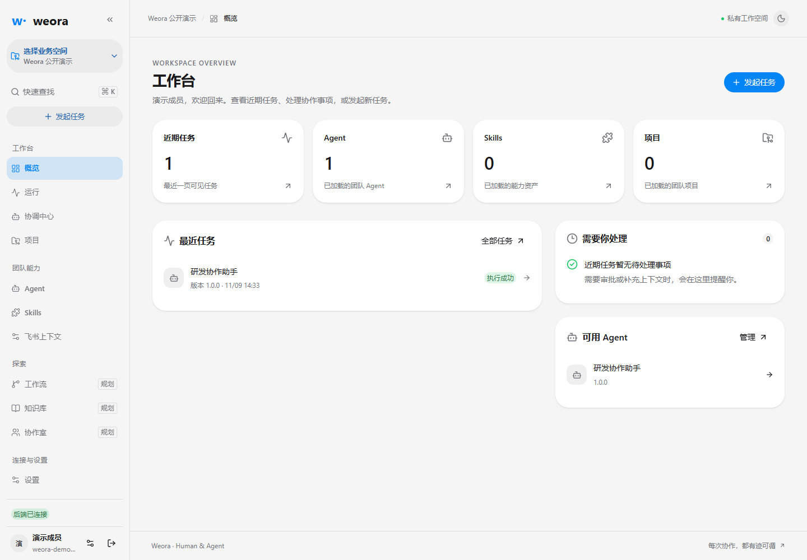
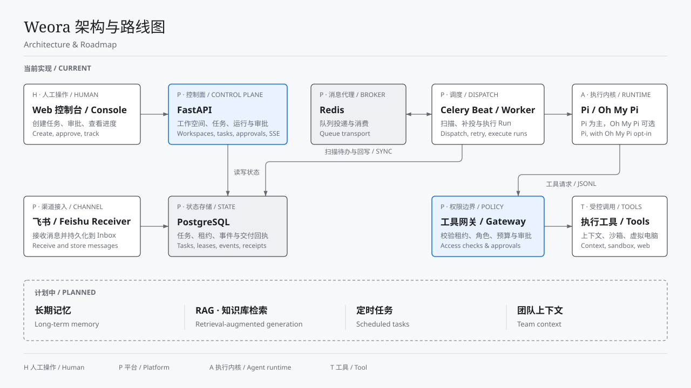

# Weora

**A self-hosted workspace for teams to work with AI agents.**

**English** · [简体中文](README.zh-CN.md) · [Quick start](#quick-start) · [Architecture](#architecture)

Weora turns a request from the web console or a Feishu thread into a task your team can follow. An agent can read authorized project context, propose a plan, and carry out approved changes. Review the plan, test results, diff, and delivery receipt in the same place.

Weora is in early development and licensed under the [MIT License](LICENSE).



## Weora in action

Imagine a teammate reports a bug in a Feishu thread:

> Find out why the export button returns an empty file. Show me the cause and your plan. After I approve it, fix the bug and run the relevant tests.

1. **Open a task.** The agent reads the authorized thread and selected repository, then proposes a plan.
2. **Review the scope.** A teammate approves the specific plan version and the actions it allows.
3. **Run the work.** The worker makes the approved changes in a Docker sandbox and records the test output and diff. With a code-hosting connection and the right permissions, it can publish a dedicated branch and open a pull request.
4. **Pick it up later.** The result can go back to the original thread. A follow-up starts another run on the same task, with the earlier context and results available.

## What you can do

- **Work from the console or Feishu.** Create tasks in the web console, route authorized Feishu mentions to a published agent, or configure an agent to observe and pick up work in selected threads.
- **Review what the agent did.** Inspect task status, run events, tool calls, approval decisions, diffs, and test evidence from the console.
- **Hand off a browser session.** Enable a task-scoped virtual computer for authorized browser work. A teammate can take control from the console, hand it back, and resume the task with its browser state.
- **Share agents and skills across a workspace.** Publish versioned agent configurations and skill packages. Manage members, project repositories, and model connections in the workspace.
- **Choose an execution engine.** Pi is the primary runtime. A team administrator can opt in to the Oh My Pi adapter for new worker runs using a configured DeepSeek connection.

## Quick start

To run the console and API from source, install **Python 3.12**, **uv**, **Node.js 22.19+**, and **pnpm 10**. Prepare a PostgreSQL database and a user with permission to run migrations.

### 1. Clone and start the API

```bash
git clone https://github.com/yuzhiyang1/weora.git
cd weora/backend
cp .env.example .env
```

Set `WEORA_DATABASE_URL` in `backend/.env` to your database connection string. Weora checks passwords by default. Local developers can explicitly opt in to the development bypass by setting `WEORA_DEVELOPMENT_AUTH_BYPASS_ENABLED=true`.

```bash
uv sync --frozen
uv run alembic upgrade head
uv run uvicorn weora.main:app --reload --host 127.0.0.1 --port 8000
```

### 2. Start the console

In a second terminal, from the repository root:

```bash
pnpm install --frozen-lockfile
pnpm dev:web
```

Open the [web console](http://localhost:5173) to register an account. The API exposes [OpenAPI docs](http://localhost:8000/docs) and a [liveness check](http://localhost:8000/api/v1/health/live).

### 3. Enable agent execution

| To use | Setup |
| --- | --- |
| Run an agent from the console | Build Pi, configure a model connection, and start Redis, Celery Worker, and Celery Beat. [Pi runtime setup](docs/development/pi-runtime-w01.md) · [Operations guide](docs/development/weora-v0.1-operations.md) |
| Start or continue tasks in Feishu | Configure an app connection, source permissions, identity bindings, and the Feishu receiver. [Feishu setup](docs/development/weora-v0.1-operations.md#5-飞书连接授权与历史) |
| Run tests or publish a change | Configure a project repository, sandbox, and any code-hosting credentials required for delivery. [Sandbox setup](runtimes/sandbox/README.md) · [Code hosting setup](docs/development/weora-w10-code-hosting.md) |
| Give a task a virtual computer | Build the optional computer runtime and grant access to specific origins. [Virtual computer setup](runtimes/openbot/README.md) |

The [local development guide](docs/development/getting-started.md) also covers Docker Compose. The base Compose stack starts the console, API, PostgreSQL, and Redis. Agent execution and the Feishu receiver run as separate processes.

## Architecture



[View full-size diagram](docs/architecture/diagrams/weora-current-architecture.svg)

The [FastAPI backend](backend/) keeps task and run state in PostgreSQL. Celery dispatches work to separate workers, and the tool gateway checks each call against its permissions. The [React console](apps/web/) reads run state and streams events from the API. See the [execution architecture](docs/architecture/execution-layer-upgrade.md) and [virtual computer design](docs/adr/0022-task-computer-and-test-credentials.md).

### Planned

- **Long-term memory** — retain useful decisions and preferences across tasks.
- **RAG** — retrieve authorized knowledge sources and cite them in agent responses.
- **Scheduled tasks** — let users configure recurring agent runs.
- **Team context** — share project conventions and decisions within a workspace.

The [CLI](apps/cli/) currently provides local command discovery and JSON Schema. Platform API commands, Codex and Claude Code runtime adapters, A2A, and visual workflows are also planned.

## Contributing

Start with the [development guide](docs/development/getting-started.md) and [engineering guide](AGENTS.md). For a bug report, include the steps to reproduce it, what you expected, and any relevant logs with credentials removed. [GitHub Issues](https://github.com/yuzhiyang1/weora/issues)

For the preview, pull requests are limited to collaborators with write access.

## License

[MIT](LICENSE)
