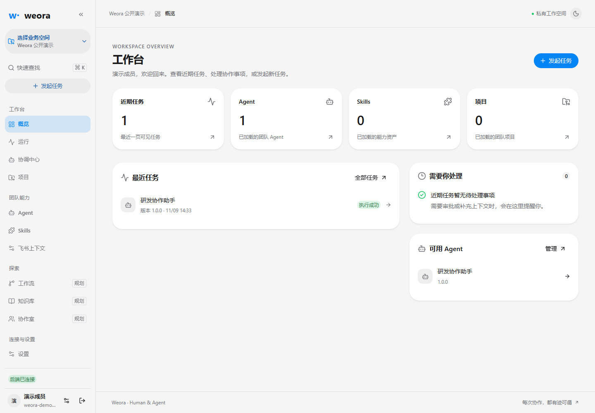
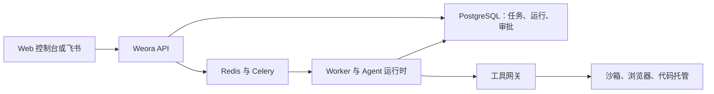

# Weora

**让团队在自己的环境里和 AI Agent 一起做事。**

[English](README.md) · **简体中文** · [快速开始](#快速开始) · [架构](#架构)

Weora 把 Web 控制台或飞书话题里的请求变成团队可以跟进的任务。Agent 读取获授权的项目资料、提出计划，并按审批范围执行。计划、测试结果、代码差异和交付回执都能在同一个地方查看。

Weora 处于早期开发阶段，采用 [MIT 许可证](LICENSE)。



## 一个任务怎么做完

假设同事在飞书话题里反馈了一个缺陷：

> 查一下为什么导出按钮生成的是空文件。先告诉我原因和修改计划，等我批准后再改代码并跑相关测试。

1. **发起任务。** Agent 读取获授权的飞书话题和选定仓库，提出修改计划。
2. **确认范围。** 团队成员审阅并批准具体版本的计划，以及其中允许的操作。
3. **执行和验证。** Worker 在 Docker 沙箱里按批准范围修改代码，记录测试输出和 Diff。配置代码托管连接并授权后，还可以推送专用分支、发起代码评审。
4. **接着做。** 结果可以回到原飞书话题。补充要求会在同一个任务下开启下一轮运行，接着使用已有的上下文和结果。

## 现在能用什么

- **从控制台或飞书开始。** 在 Web 控制台创建任务，配置飞书机器人在获授权的来源响应 `@`，也可以让 Agent 在指定话题观察消息或自动接单。
- **查看每一步的依据。** 在控制台查看任务状态、运行事件、工具调用、审批决定、代码差异和测试证据。
- **接管浏览器继续工作。** 按任务启用虚拟电脑，授权 Agent 操作浏览器。团队成员可以在控制台接管、交还，任务续接时可沿用浏览器状态。
- **让团队复用 Agent 和 Skill。** 在工作空间管理成员、项目仓库和模型连接，发布带版本的 Agent 配置和 Skill 包。
- **选择执行内核。** Pi 是主要运行时。团队管理员可为新的 Worker 运行选用 Oh My Pi 适配器，使用已配置的 DeepSeek 连接。

## 快速开始

从源码启动控制台和 API，需要 **Python 3.12**、**uv**、**Node.js 22.19+** 和 **pnpm 10**。先准备一个 PostgreSQL 数据库，以及有权限执行迁移的数据库用户。

### 1. 克隆仓库并启动 API

```bash
git clone https://github.com/yuzhiyang1/weora.git
cd weora/backend
cp .env.example .env
```

在 `backend/.env` 中填写自己的 `WEORA_DATABASE_URL`。Weora 默认校验密码。本地开发如需临时跳过校验，可显式设置 `WEORA_DEVELOPMENT_AUTH_BYPASS_ENABLED=true`。

```bash
uv sync --frozen
uv run alembic upgrade head
uv run uvicorn weora.main:app --reload --host 127.0.0.1 --port 8000
```

### 2. 启动控制台

另开一个终端，在仓库根目录运行：

```bash
pnpm install --frozen-lockfile
pnpm dev:web
```

打开 [Web 控制台](http://localhost:5173) 注册账号。后端提供 [OpenAPI 文档](http://localhost:8000/docs) 和 [存活检查](http://localhost:8000/api/v1/health/live)。

### 3. 启用 Agent 执行

| 想做什么 | 需要的配置 |
| --- | --- |
| 在控制台运行 Agent | 构建 Pi、配置模型连接，并启动 Redis、Celery Worker 和 Celery Beat。[Pi 配置](docs/development/pi-runtime-w01.md) · [运行手册](docs/development/weora-v0.1-operations.md) |
| 从飞书发起或续接任务 | 配置飞书应用、来源授权、用户绑定和飞书接收器。[飞书配置](docs/development/weora-v0.1-operations.md#5-飞书连接授权与历史) |
| 跑测试或发布改动 | 配置项目仓库、执行沙箱和交付所需的代码托管凭据。[沙箱配置](runtimes/sandbox/README.md) · [代码托管配置](docs/development/weora-w10-code-hosting.md) |
| 给任务分配虚拟电脑 | 构建可选的电脑运行时，为任务授权可访问的站点。[虚拟电脑配置](runtimes/openbot/README.md) |

[本地开发指南](docs/development/getting-started.md)也提供 Docker Compose 的启动方式。基础 Compose 会启动控制台、API、PostgreSQL 和 Redis。Agent 执行进程与飞书接收器需要单独启动。

## 架构



[FastAPI 后端](backend/)把任务和运行状态保存到 PostgreSQL。Celery 将工作交给独立的 Worker，工具网关逐次检查调用权限。[React 控制台](apps/web/)通过 API 读取状态和实时事件。参见[执行层架构](docs/architecture/execution-layer-upgrade.md)和[虚拟电脑设计](docs/adr/0022-task-computer-and-test-credentials.md)。

[CLI](apps/cli/)已支持本地命令发现和 JSON Schema。业务 API 命令、Codex 和 Claude Code 运行时适配、A2A、可视化工作流及知识库仍在规划中。

## 参与贡献

从[本地开发指南](docs/development/getting-started.md)和[工程协作指南](AGENTS.md)开始。反馈缺陷时，请附上复现步骤、预期结果和已移除凭据的相关日志。[GitHub Issues](https://github.com/yuzhiyang1/weora/issues)

预览阶段仅具有写权限的协作者可以创建 PR。

## 许可证

[MIT](LICENSE)
