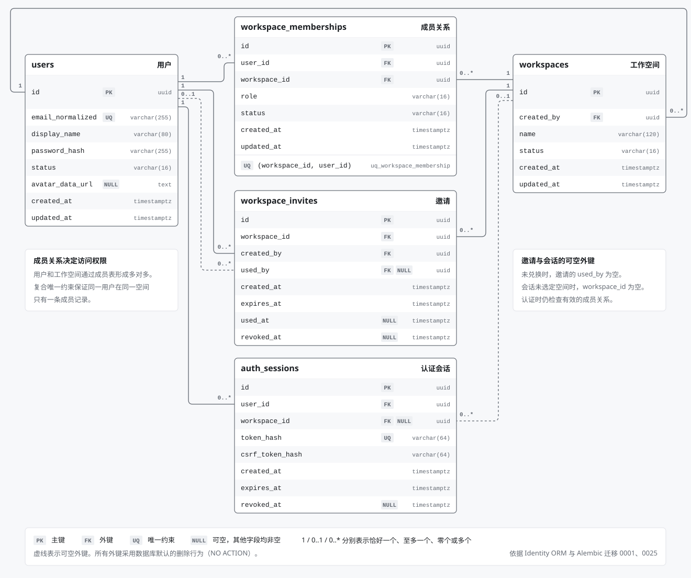

# ADR 0024 工作空间邀请链接与会话选择

- 状态：已采纳。
- 设计：[工作空间 · 链接邀请](https://www.figma.com/design/K5VJU1uMXW397Frkq79zph?node-id=23-62)

工作空间所有者和管理员可创建、复制或撤销一次性邀请链接。链接默认 7 天有效，也可选 24 小时。持有有效链接的人可以确认以普通成员身份加入。已有成员使用有效链接切换空间时不消耗邀请。公开注册关闭时，有效邀请仍可用于注册。受邀注册在同一事务创建账号、兑换邀请并建立会话，直接进入受邀空间。

浏览器用 `/join#令牌` 传递链接，预览和兑换在请求正文发送令牌。部署以 `WEORA_WORKSPACE_INVITE_KEY` 配置独立的稳定随机密钥，至少 32 字节，所有 API 实例使用同一个值。数据库仅保存邀请标识、生命周期和操作者；链接由服务端签名，可按原有效记录重新复制。更换密钥会使此前分享的链接失效。管理员可重新复制仍有效记录的链接。

兑换、撤销和移除成员在目标工作空间的锁下复查权威状态。已用、过期或撤销的链接拒绝新成员。撤销只影响邀请，移除成员单独执行并记录审计。成员访问仍由实际成员关系决定；最后一个成员关系被移除时注销旧会话。用户可凭新邀请重新加入。

当前空间保存在会话。每次恢复时优先使用仍有效的已选空间，旧会话和已选空间失效时沿用最早的有效成员关系。控制台在「设置 → 个人资料 → 我的工作空间」提供切换入口。

数据库迁移为 `20261110_0025`。已有邀请记录时迁移拒绝有损回退。

## 数据模型

[打开离线 HTML 原图](../architecture/diagrams/workspace-invites-er.html)
