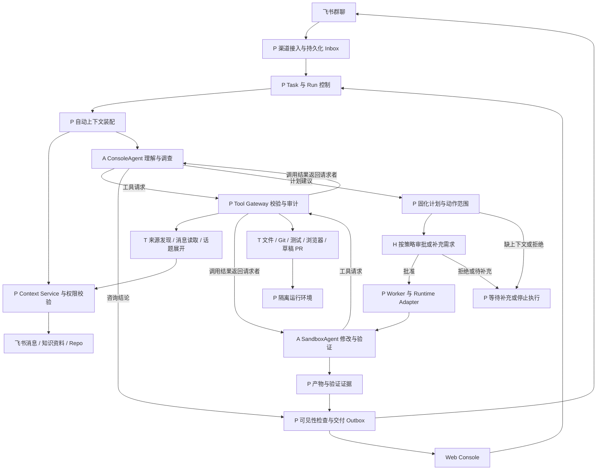

# Weora 研发 Agent 与飞书上下文架构

- 状态：第一版设计草案，尚未实现的能力按开发计划推进
- 日期：2026-10-17
- 产品范围：[飞书上下文设计](../product/feishu-context-v0.1-design.md)
- 实现顺序：[第一版开发计划](../development/weora-v0.1-implementation-plan.md)
- 架构提案：[ADR 0003](../adr/0003-agent-execution-and-feishu-context.md)
- 图表源文件：[离线图表与绘制说明](diagrams/README.md)
- 2026-10-20 项目资料实现增量：[ADR 0006](../adr/0006-projects-and-selected-repository-context.md)。Console 开发者自助配置多仓库；平台按任务明确选择冻结项目资料并注入 Runtime，Agent 不决定扩权或获取凭据。当前仅登记与资料上下文，动态仓库代码物化/跨仓执行未实现，不改变原图中的审批与 Tool 边界。

## 1. 目标与边界

Weora 独立提供团队研发 Agent 能力。用户从 Web Console 或飞书提出需求，ConsoleAgent 理解目标、补充证据并制定计划，SandboxAgent 在隔离环境中执行、验证并交付。Plane、禅道等项目管理系统不是核心依赖，未来通过独立 Tool Adapter 接入。

ConsoleAgent 和 SandboxAgent 是逻辑职责，不等于两个微服务，也不要求使用不同模型。第一版允许同一 Runtime 分别执行两个角色，但必须区分工具权限、执行环境和运行步骤。不先建设通用多 Agent 编排器、可视化工作流编辑器或完整项目管理系统。

职责标记：P 为平台代码，A 为 Agent 决策，T 为确定性工具实现，H 为人类。Tool 本身也是代码；单独标记 T 是为了说明哪些能力可以被 Agent 按需调用，而不是另建一种服务。

## 2. 总体架构

[打开离线 HTML](diagrams/weora-overview.html) · [查看 SVG](diagrams/weora-overview.svg)

总览将请求接入与 Run 控制、计划固化、Runtime 调度、产物与回报分别合并展示。上下文服务见下一张细节图；拒绝、等待、取消与恢复规则仍以第 5 节为准，不因总览省略分支而取消这些状态。

展开完整逻辑关系参考

图中 Tool 结果只返回发起调用的角色。ConsoleAgent 不会因为共用 Gateway 而收到 SandboxAgent 的所有消息，反之亦然。Gateway 对每次调用重新校验，审批不是绕过后续权限检查的通行证。

## 3. 平台与 Agent 的责任分界

| 能力 | P 平台负责 | A Agent 决定 | T 工具执行 |
| --- | --- | --- | --- |
| 接收请求 | 验签或连接认证、身份映射、持久化、去重、路由 | 理解用户意图 | 不参与入站处理 |
| 自动补齐当前讨论 | 根据固定规则读取引用、话题和邻近消息，限时限量装配 | 判断补齐后的证据是否足够 | 复用底层读取服务，不要求模型先发起 Tool Calling |
| 主动查询历史 | 限定可见来源、时间、预算和输出受众 | 选择来源、时间窗口、下一页和需展开的话题 | 返回结构化消息、引用与覆盖范围 |
| 制定与批准计划 | 保存计划版本、审批记录和允许动作 | 拆任务、选方案、发现冲突并追问 | 读取代码与资料，不能自己批准计划 |
| 改码与验证 | 分配沙箱、限制网络与进程、保管凭据 | 决定修改位置、测试方法和下一步 | 文件、Git、命令、浏览器等实际操作 |
| 完成与交付 | 检查必需证据、输出受众、落地产物并投递通知 | 解释结果、剩余风险和未解决事项 | 上传产物、创建草稿 PR、发送指定渠道消息 |
| 故障与恢复 | 状态机、租约、重试边界、取消和审计 | 在允许范围内调整方案 | 返回明确错误，不将权限失败伪装成空结果 |

对“如何补入”的回答是：自动补齐主要写平台逻辑；主动查询主要由 Agent 选择、Tool 执行。两条路径共享 Context Service，不能各自实现一套权限或飞书分页逻辑。

### 3.1 飞书上下文的两条路径

[打开离线 HTML](diagrams/feishu-context.html) · [查看 SVG](diagrams/feishu-context.svg)

上方路径由平台在首次模型调用前执行，下方路径由运行中的 Agent 选择工具。图中的查询决策与结果接收可以属于同一个 Agent；返回内容仅装配到对应 Run 并回给调用角色，不广播给其他 Agent。FeishuReader 只交付一种可用实现，CLI 标注为候选，不是第一版新增前置条件。

## 4. 控制面与执行面

沿用模块化单体，使用独立 FastAPI、Celery Worker、渠道连接进程区分生命周期。PostgreSQL 是任务、运行、事件和投递状态的事实来源；Redis 用于缓存、限流、队列和事件通知，不是唯一记录。

第一版沿用已有 ADR 的 Pi 首个 Runtime 方向。Worker 通过 Runtime Adapter 传入中立上下文并消费文本、工具请求和完成事件；Pi 的消息类型与会话文件不得成为业务模型。若 Pi 使用独立子进程，采用受限的结构化进程协议，不让 Runtime 绕过 Tool Gateway 直接调用业务凭据或宿主机任意命令。

单 Agent 工具循环是第一条执行链路，不以完成 Graphon 适配为前置条件。后续工作流能力仍通过既有 `WorkflowEngine` 端口接入，不把当前编排逻辑绑死在 Pi 或飞书 SDK 上。

### 4.1 模块归属

以下是进入对应功能开发后再创建的边界，不要求现在生成空目录。当前实际业务模块位于 `backend/src/weora/modules/`。

| 模块 | 责任与主要数据 |
| --- | --- |
| identity，已有 | 用户、工作空间、成员；提供权限查询，不由渠道复制成员模型 |
| agents 与 skills，已有 | 草稿、发布版本、固定 Skill 包及静态 Runtime 输入 |
| collaboration，新增 | Task、计划版本、审批、交付产物；第一版只做任务所需能力 |
| runs，新增 | Run、步骤、RunEvent、检查点、预算、租约与恢复 |
| tools，新增 | 工具定义、调用记录、策略执行、凭据代理与调用结果 |
| context，新增 | 来源目录、授权、集合、内容快照和上下文装配 |
| channels，新增 | 飞书连接、身份绑定、Inbox、会话路由、消息投递 Outbox |
| Runtime 与 Feishu Adapter | 分别实现执行和读取端口；通过应用层协作，不跨模块操作 ORM |

对象存储复用[已有供应商中立端口](object-storage-module-design.md)。产物下载必须先经过业务权限检查，再生成短时访问方式；敏感上下文不生成长期公开链接。

### 4.2 静态版本与动态上下文

- `AgentVersion` 固定提示词和 SkillVersion，遵守[已有 ADR](../adr/0002-agent-version-and-runtime-adapter-boundary.md)。群聊记录不能写回发布版本。
- 每次 Run 固定角色使用的 AgentVersion、模型配置标识、来源授权快照、输入、输出受众和时间截止点。授权快照用于解释历史，不覆盖实时撤权。
- 动态消息与 Tool 结果属于 Run 上下文。保存 ContextSnapshot 的来源、抓取时间、内容摘要、覆盖状态和引用，使“当时读到了什么”可追踪。
- 飞书消息、Repo 文本、附件和 Skill 参考材料均按各自信任级别作为数据输入；其中夹带的指令不能改变系统策略、身份或审批范围。
- 重建上下文不等于重放外部副作用，也不承诺模型输出逐字可复现。

## 5. Task 与 Run 生命周期

Task 表示用户目标；Run 表示一次执行尝试。第一版一个 Task 同时最多一个活跃 Run；失败后显式新建尝试并保留前次记录。角色切换记为 Run 步骤，不以无限互相调用实现协作。

Run 状态采用：`QUEUED`、`RUNNING`、`WAITING_CONTEXT`、`WAITING_APPROVAL`、`RECOVERY_REQUIRED`、`SUCCEEDED`、`FAILED`、`CANCELLED`。仅后三种为终态。

- 首次模型调用前自动装配上下文；若无法确认任务依赖的历史约定，进入 `WAITING_CONTEXT`，不能靠猜测继续改码。
- 模型建议执行不等于批准。平台保存计划、版本和动作范围，人类按策略批准后才发放执行权限；计划或目标仓库实质变化需要重新批准。
- `SUCCEEDED` 由平台依据任务交付契约及已记录证据判定，不接受一句“完成了”作为唯一条件。测试退出码与截图是证据，是否覆盖目标仍需 Agent 说明或人类确认。
- 拒绝执行计划终止该次 Run，记录拒绝原因；需要修改计划时保持等待并生成新计划版本。取消必须停止后续调度并尽力终止子进程，迟到结果不得复活运行。
- Worker 使用带租约的原子领取和 fencing token。租约失效的 Worker 不得提交新状态或发起新调用；无法确定外部动作结果时进入 `RECOVERY_REQUIRED`，先核对再恢复，不自动重放写操作。
- RunEvent 使用每 Run 单调序号；SSE 从持久化序号续读。事件中区分平台事实、工具执行证据与 Agent 判断，不把推测写成验证通过。

## 6. 权限与交付不变量

上下文可读范围取应用实际能力、工作空间来源授权、发起人权限、Run 授权及输出受众许可的交集。每次读取、缓存命中、快照预览、恢复和交付都重新检查。具体规则见[飞书设计](../product/feishu-context-v0.1-design.md)。

第一版采取保守规则：来自群 A 的 Run 不读取私有群 B 的上下文；Console 私有 Run 可以读取本人获授权的多个来源，但不能直接转成共享 Run 或转发到群 A。内容、推导答案与产物继承来源限制，不能仅依靠模型“不要泄漏”的提示词。

高风险工具必须经平台策略授权。沙箱内不挂载宿主机 Docker Socket、全盘目录或长期凭据；出站网络、仓库路径、命令和资源预算按 Run 限制。文件引用不能穿越路径边界，模型也不能自行指定任意命令执行身份。

入站持久化后再确认接收；异步补上下文和执行。出站通过 Outbox 重试与对账，记录发送尝试和远端消息 ID，不声称跨飞书网络调用能够无条件 exactly-once。通知失败不覆盖真实执行结果，应显示“执行完成，投递待恢复”。

## 7. 当前基线与第一版终点

截至 2026-10-17 当前工作树已有身份、Agent 注册、Skill 注册、Runtime 静态材料、私有 Console Run 的持久化/API，并已加入 Celery 调度入口、Worker 租约/fencing、结果保存及 Pi 1.3.0 无工具文本适配器。真实 PostgreSQL/Redis/Celery 与 DeepSeek 联调仍未完成，SSE、Console 运行页、Tool Calling、飞书渠道和沙箱执行尚未实现；其中包含未提交变更，不能据此认定为已发布能力。逐项证据及未验证边界见[第一版实现进度](../development/weora-v0.1-progress.md)和[执行运行手册](../development/pi-runtime-w01.md)。

第一版终点是两条真实闭环：一是 Console 或飞书发起上下文查询，得到带来源且明确覆盖范围的结论；二是批准研发计划后，在隔离仓库中改码、验证并查看 Diff、测试结果、报告及按授权创建的草稿 PR。浏览器验证只在任务需要且环境已配置时执行，不伪造截图或将未运行的检查显示为通过。

## 8. HiFox 参考设计与第一版取舍

HiFox 将飞书入口、资源连接器与组织通知分开，并提供话题与任务关联。Weora 借鉴职责边界，不照搬其产品分组、授权流程或功能规模。[HiFox 飞书集成说明](https://help.hifox.com/docs/integration/feishu)

### 8.1 接入与授权分层

[打开离线 HTML](diagrams/feishu-boundaries.html) · [查看 SVG](diagrams/feishu-boundaries.svg)

此图展示使用飞书上下文的 Run 的约束关系，不是完整执行时序。读取后产生的结果仍需经过独立交付校验；图中的原会话回报不代表个人通知或评论双向同步。

| 边界 | 平台需要回答的问题 | 第一版落点 |
| --- | --- | --- |
| 渠道绑定 | 哪个连接、群和话题的消息交给哪个 Agent？ | channels 的 ConversationBinding，按现有 W06 实现 |
| 用户关联 | 发起消息的飞书身份对应哪个有效 Weora 成员？ | FeishuIdentityBinding；由既有管理入口验证，不引入个人 OAuth |
| 工具授权 | 当前 Run 能以哪种身份读取哪些来源？ | context 来源授权与 Tool Gateway；固定应用身份，不能由模型切换 |
| 通知交付 | 哪个结果允许回到哪个会话？ | DeliveryOutbox 与受众校验；仅回报原始授权会话 |

第一版可以继续使用一个连接设置页，不创建四套助手或独立微服务。上述状态不能合并为一个“已绑定”布尔值：身份已关联不授予来源读取权，渠道已连接不证明历史可读，历史可读也不意味着可以向任意群发送结果。连接断开、成员解绑、来源撤权和投递失败分别影响对应能力，不应互相冒充。

### 8.2 凭据托管与读取适配器

HiFox 的本地飞书连接器声明使用官方 CLI，随包说明列出历史、搜索和话题读取能力；官方产品文档也说明连接器凭据由平台管理。[HiFox Agent 连接器说明](https://help.hifox.com/docs/agent-and-computer/agents)

Weora 保持 `Agent → Context Tool → Context Service → FeishuReader Adapter` 的调用边界。第一版只需交付一种通过契约测试的读取适配器；SDK/API 或官方 CLI 是底层实现选择，不新增面向 Agent 的任意 CLI 执行工具，不将关键词搜索加入现有四个工具的交付范围。

CLI 仅作为候选，不要求在 W04 前完成 CLI 接入，也不要求 SDK 与 CLI 双实现。若采用 CLI，必须固定版本与应用身份，使用结构化参数而非拼接 shell，隔离配置与凭据，验证 JSON 输出、分页、超时、撤权及错误映射；无法满足约束时使用 SDK/API。平台仍强制校验来源、预算、快照与受众，不能以 CLI 自带认证替代这些检查，也不能依赖开发者电脑的个人登录态。

第一版凭据仍属于工作空间内的飞书连接，由后台托管；Run 只记录非敏感凭据引用及身份类型。缺失、失效或身份冲突时明确失败，不随机选择凭据，不自动降级为个人身份。通用凭据中心、个人或项目级凭据共享、跨 Agent 绑定向导均不属于第一版。

### 8.3 话题来源与参与者身份

会话路由、任务来源和消息同步是三个不同概念。第一版仅保存任务来源引用及原会话交付目标，包括工作空间、连接、群、可空话题及触发消息 ID；继续使用现有 Task/Run 与 Outbox，不新增独立绑定管理页。ConversationBinding 不承担任务评论同步职责，也不能以同一群或话题作为消息去重键，吞掉后续显式请求。

2026-11-03 起，后续显式 @ 请求可通过话题或引用续接同一 Task，活跃 Run 期间持久排队，终结后启动新 Run 并装配有界历史，见 [ADR 0015](../adr/0015-task-continuations.md)。不因普通话题消息自动启动 Run，也不自动追补缺口；不得悄悄改写正在执行的 Run 输入或已批准计划。全话题订阅及主动执行属于[执行层升级后续阶段](execution-layer-upgrade.md)，不再作为不可调整的产品限制。

未来若引入独立 `TaskThreadBinding` 与双向同步，再设计唯一绑定、同步阶段、停止与恢复、回填和防循环规则。第一版原会话回报已需记录来源与远端发送 ID，并避免机器人自身消息触发自己；这属于 W06、W10 的既有去重和交付约束，不等于承诺完整双向同步。

历史消息中的其他参与者可以保留外部作者 ID、来源连接和显示名，无法确认时显示原始标识；不要求所有作者先成为 Weora 成员。不据此创建可登录账号，不按姓名或邮箱自动授予关联，更不让未绑定的请求发起人获得触发、读取或执行权限。第一版不建设独立外部账号中心。

### 8.4 参考证据与范围约束

参考日期为 2026-10-17。产品事实来自本节链接的 HiFox 官方文档；本地安装包标注版本为 `0.4.420`，不代表云端服务或独立更新的连接器版本。可复核的本地参考位置均位于用户目录的 `.hifox/connectors-marketplace/connectors/`：

- `feishu/cli.json`：声明 CLI 初始化、认证与状态检查，并要求用户身份状态；这是连接器配置，不证明 Weora 应采用用户身份，也不代表云端托管凭据的完整实现。
- `feishu/skills/lark-im/references/lark-im-chat-messages-list.md` 与 `lark-im-threads-messages-list.md`：历史读取、话题展开与分页契约参考。
- `feishu/skills/lark-im/references/lark-im-messages-search.md`：搜索能力的后续参考，不纳入第一版工具列表。
- `lark-mcp/mcp.json`：声明 `preAuthConnector: feishu`，体现工具连接复用前置授权的配置边界；第一版不因此新增 MCP 飞书接入。

上述本地文件不含本次授权联调结果，不能作为实际账号已具备读取权的证据。只参考设计与行为契约，不复制上游源码、品牌、凭据或用户数据。

第一版仍为中国大陆飞书自建应用、应用身份、显式来源授权、自动讨论补齐、四个主动查询工具与原会话结果回报。个人 OAuth、扫码授权、完整双向同步、跨群关键词搜索、链接预览卡片、独立个人通知、表情或普通群消息触发均后置，不新增第一版任务或发布阻塞项。
