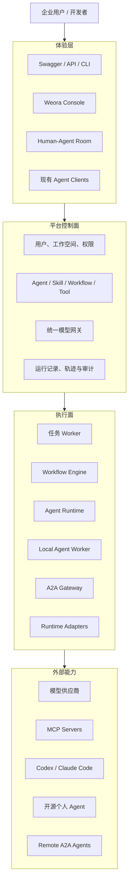
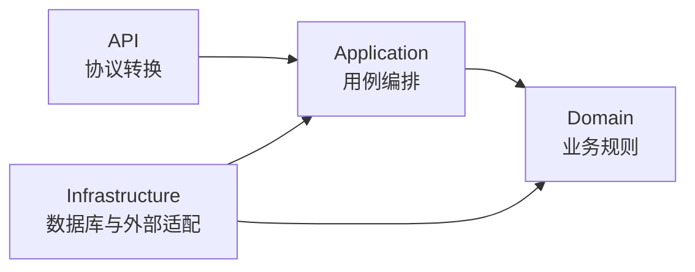

# 第 1 课：团队已经在使用 Agent，为什么还要做 Weora

## 本课定位

这节课面向已经具备后端开发基础、希望从 0 到 1 完成企业级 Agent 项目的开发者。

本课不讲 Python 语法，也不展开前端实现。完成本课后，学习者应该能够：

1. 用自己的话解释 Weora 要解决的企业问题。
2. 看懂 Weora 的整体架构以及控制面、执行面的区别。
3. 理解主要技术选择背后的原因。
4. 理解 Weora 如何以实用型 DDD 组织后端代码。
5. 知道后续阅读代码时应该从哪里进入。

本课只建立共同认知和代码地图。技术细节、异常处理和具体实现会放在后续功能代码中讲解。

---

## 1. 背景故事：工具越来越强，团队却越来越分散

我们团队一直在尝试使用 AI 提效，甚至希望用 AI 重构原有工作流。

在这个过程中，我们做过很多尝试：

- 使用扣子平台搭建面向内部和 C 端业务的 Agent。
- 根据具体业务自行开发 Agent 工具和小工具。
- 开发浏览器插件，把 AI 能力嵌入现有工作流程。
- 在研发团队中使用 Codex、Claude Code 等 Coding Agent。

早期，自建 Agent 和小工具能够解决很多具体问题。但随着 Codex、Claude Code 等大厂 Agent 快速发展，研发岗位的大量需求已经能够直接由这些工具覆盖。团队成员开始使用各自熟悉的 Coding Agent，真正持续使用扣子的主要变成了运营、文案等少数岗位。

扣子企业版具备比较完整的平台能力，但对于团队中的实际使用人数来说，价格偏高。另一方面，公司能够通过其他模型平台的商务合作获得更低的 Token 价格，这些模型却不能直接接入扣子。在当时的接入条件下，我们只能先接入小龙虾等面向个人的开源 Agent。

这类开源 Agent 对个人提效很有效，但对团队提效仍然有限。

最典型的问题是 Skill 的共享：

- 有编程基础的人先把 Skill 上传到 Git 仓库，再通知其他开发者自行下载。
- 没有编程基础的同事只能接收压缩包，再按照说明手动安装。
- 同一个 Skill 在 Codex、Claude Code 和其他 Agent 中可能需要不同的目录、配置和格式。
- 每个团队都有自己的 AI 提效技巧，但这些技巧经常被绑定在某个具体工具中，无法直接复用。

最终出现了一个看似矛盾的现象：

> 团队里的每个人都开始使用 Agent，但大家使用得乱七八糟；个人效率提高了，团队经验却没有真正沉淀下来。

现有平台已经能够解决很多 Agent 构建问题，Codex、Claude Code 等工具也越来越强。真正没有被解决好的，是如何把这些不同工具连接起来，让个人技巧变成团队能够发现、安装、复用和持续改进的组织资产。

这就是我们决定打造 Weora 的原因。

## 2. Weora 要解决什么问题

Weora 不是因为市场上缺少 Agent 平台才被创建。它要解决的是不同平台、模型和 Agent Runtime 共同存在时，团队如何形成统一的效率体系。

### 2.1 异构工具接入

团队成员可以继续使用 Codex、Claude Code、开源 Agent 或平台内置 Agent。Weora 通过 Runtime Adapter、MCP 和 A2A 等方式连接它们，不要求所有人迁移到同一个客户端。

### 2.2 模型资源统一使用

统一接入企业采购或商务合作获得的模型资源，根据成本、能力和合规要求选择模型，避免模型资源被锁定在某个平台中。

### 2.3 团队资产沉淀

将个人积累的 Skill、Prompt、Agent、工作流、工具和知识库变成有版本、有说明、有兼容目标的组织资产，让非技术岗位也能够低成本发现、安装和使用。

### 2.4 协作与治理

让人类、平台 Agent、A2A Agent 和本地 Coding Agent 围绕同一个项目协作，同时保留工作空间、权限、密钥、成本、版本、审批、运行轨迹和审计能力。

因此，Weora 的核心不是再提供一个更大的 Agent 功能列表，而是：

> 让工具差异不再阻碍团队共享能力，让个人 AI 技巧能够转化为持续积累的组织能力。

## 3. Weora 不是什么

明确“不做什么”能够帮助项目保持边界：

- Weora 不是大模型训练平台。
- Weora 不是只有聊天页面的 AI 套壳应用。
- Weora 不是因为 Dify 或扣子缺少企业能力而重新实现一遍。
- Weora 不重新实现 Codex 或 Claude Code，而是把它们作为 Runtime 接入。
- Weora 不强迫所有岗位使用同一种 Agent 客户端。
- Weora 不以一次成功演示作为功能完成标准。
- Weora 第一阶段不会同时实现所有企业能力。

项目会先建立可靠的后端基础和统一资产模型，再逐步实现模型接入、Skill Registry、Agent、工作流、知识库、工具和 Human-Agent 协作。

## 4. 整体架构

Weora 可以从四个层次理解：



### 控制面

控制面回答“系统里有什么”和“允许做什么”：

- 谁属于哪个工作空间。
- 谁能够查看、编辑和发布 Agent、Skill、工作流和工具。
- 一个 Skill 有哪些版本，兼容哪些 Agent Runtime。
- 企业采购的不同模型应该如何路由。
- 一次运行使用了哪个版本。
- 运行产生了哪些事件、成本和审计记录。

### 执行面

执行面回答“任务如何真正运行”：

- 调用哪个模型。
- 如何将 Skill 转换并分发到不同 Agent Runtime。
- 按什么顺序执行工作流节点。
- 如何调用工具和 MCP。
- 如何暂停、恢复、重试和取消。
- 如何把运行事件持续返回给调用方。

控制面和执行面可以先放在同一个仓库，但需要通过数据库、消息和稳定接口协作，不能依赖进程内的临时状态。

## 5. 技术选型

Weora 参考 Dify 已经验证过的 Python Agent 平台组合，同时对新项目作出少量现代化调整。

| 领域 | Weora 选择 | 选择原因 |
| --- | --- | --- |
| Python | Python 3.12 | 与 Dify 和 Graphon 生态兼容，降低依赖风险 |
| 依赖管理 | uv | 快速安装并通过 `uv.lock` 保证环境可复现 |
| API | FastAPI、Pydantic v2 | 类型驱动，自带 OpenAPI，适合后端课程和流式接口 |
| 数据库 | PostgreSQL | 保存企业业务数据和权威运行状态 |
| ORM 与迁移 | SQLAlchemy 2、Alembic | 显式事务、类型映射和可追踪数据库变更 |
| 缓存与消息 | Redis | 缓存、限流、幂等和短期运行事件 |
| 后台任务 | Celery | 运行粗粒度后台任务和定时任务 |
| 工作流引擎 | Graphon Adapter | 复用图执行能力，同时避免领域模型绑定具体框架 |
| 对象存储 | Provider 无关端口、阿里云 OSS 优先、S3 兼容 Adapter 按需接入 | 保存 Skill 包、知识库原文件、附件和运行产物，并通过启动配置切换已实现的 Provider |
| 可观测性 | OpenTelemetry、结构化日志 | 关联请求、运行、节点和外部调用 |
| 测试 | pytest、HTTPX、Testcontainers | 同时覆盖领域逻辑、API 和真实基础设施 |
| 本地部署 | Docker Compose | 让开发环境能够低成本复现 |

Dify 当前后端使用 Python 3.12、uv、Celery、Redis、Graphon、OpenTelemetry、pytest 和 Testcontainers，可以作为技术基线参考：[Dify API pyproject.toml](https://github.com/langgenius/dify/blob/main/api/pyproject.toml)。

但 Weora 不直接复制 Dify：

- Dify 使用 Flask，Weora 新项目使用 FastAPI。
- Dify 的历史模块已经很复杂，Weora 按功能演进逐步增加基础设施。
- Dify 和 Coze Studio 只提供参考事实，Weora 保留自己的领域模型和接口。
- 上游代码受到各自许可证约束，参考设计不等于复制源码。

## 6. 为什么使用实用型 DDD

如果把所有代码分别放进全局 `controllers`、`services` 和 `models`，项目小时很容易理解；项目变大后，同一个业务能力会散落在多个巨大目录中。

Weora 首先按业务能力划分模块：

```text
identity          用户、工作空间和权限
agents            Agent 草稿、版本和发布
skills            Skill 包、版本、兼容目标、发布和分发
workflows         工作流定义、发布和执行入口
knowledge         文档、切片、索引和检索
tools             Tool、插件和 MCP
runs              运行、步骤、事件、轨迹和恢复
collaboration     Human-Agent 项目协作
interoperability  A2A 和本地 Coding Agent
```

每个复杂模块再划分四层：



### API 层

处理 HTTP、认证上下文、请求校验和响应序列化，不编写业务规则。

### Application 层

表达用户用例，负责事务、Repository、外部端口和领域事件的编排。

### Domain 层

保存核心业务对象、状态变化、业务不变量和领域异常，不依赖 FastAPI、SQLAlchemy、Celery 或 Graphon。

### Infrastructure 层

实现数据库、Redis、Celery、对象存储、Graphon、模型供应商、MCP 和 A2A 适配器。

## 7. 用“发布共享 Skill”理解分层

假设一名开发者希望把自己使用的 Skill 发布给整个团队，并让 Codex、Claude Code 等不同 Runtime 都能够安装。

整个过程可以这样分工：

1. API 层接收 Skill 包、版本说明和目标 Runtime，并转换当前用户和工作空间上下文。
2. Application 层检查发布权限并发起 `PublishSkill` 用例。
3. Domain 层验证名称、版本、清单、兼容目标和发布状态。
4. Domain 层生成不可变的 `SkillVersion`。
5. Infrastructure 层保存 Skill 文件、内容校验值、版本元数据和审计记录。
6. Application 层发布 `SkillPublished` 事件。
7. Runtime Adapter 根据目标格式完成后续分发或安装。
8. API 层返回发布结果。

这里最重要的不是目录名称，而是让每种变化出现在合理的位置：

- HTTP 协议变化不应该影响领域规则。
- PostgreSQL 或对象存储变化不应该改变 Skill 发布的业务含义。
- Codex、Claude Code 改变 Skill 目录格式时，只需要调整对应 Runtime Adapter。
- 一个已发布版本必须保持不变，才能让团队知道自己安装的到底是哪份能力。

## 8. Weora 使用 DDD 的尺度

Weora 不追求严格或教科书式 DDD：

- 简单查询可以直接使用清晰的应用服务。
- 不要求每张表创建 Repository。
- 不要求每个动作都创建一个类。
- 不要求为了依赖注入包装稳定的纯函数。
- 不提前设计还没有真实业务的聚合和领域事件。

只有当一段代码承载业务不变量、外部依赖、替换需求或复杂测试边界时，才值得增加抽象。

判断标准不是“目录够不够漂亮”，而是：

> 当数据库、框架或供应商变化时，核心业务规则是否仍然容易理解和测试。

## 9. 后续如何阅读代码

进入一个新功能时，建议按以下顺序阅读：

1. 从 API 找到用户能够执行的操作。
2. 进入 Application 理解完整用例和副作用。
3. 进入 Domain 理解业务状态和不变量。
4. 最后进入 Infrastructure 查看数据库和外部系统细节。
5. 通过测试确认正常路径、失败路径和恢复路径。

项目的长期架构约束记录在根目录 [`AGENTS.md`](../../AGENTS.md)，Dify 与 Coze Studio 的源码入口记录在[企业能力源码地图](../research/enterprise-capability-source-map.md)。

## 10. 本课自检

尝试在不查看答案的情况下，为下面的代码找到所属层：

```text
FastAPI Skill 发布接口
PublishSkill 用例
SkillVersion 及其兼容规则
SQLAlchemy Skill Repository
Codex / Claude Code Skill Adapter
```

<details>
<summary>查看答案</summary>

```text
FastAPI Skill 发布接口                  -> API
PublishSkill 用例                       -> Application
SkillVersion 及其兼容规则                -> Domain
SQLAlchemy Skill Repository             -> Infrastructure
Codex / Claude Code Skill Adapter       -> Infrastructure
```

</details>

如果能够解释每个答案背后的依赖方向，就已经掌握了本课的方法。

## 11. 本课结论

请记住四句话：

1. Weora 不是为了重复 Dify 或扣子的能力，而是连接团队已经在使用的不同 Agent。
2. 平台要把模型、Skill、Agent、工作流和工具从个人资源变成组织资产。
3. 控制面负责资产和治理，执行面通过适配器连接不同 Runtime。
4. DDD 的价值是让组织资产、业务规则和外部工具保持清晰边界。

下一课将把这些决策落成一个真正可运行、可测试的 Python 后端工程基线。
