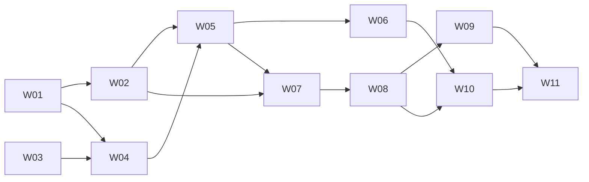

# Weora 第一版开发任务与实现顺序

- 状态：W01–W11 的代码链路已实施并进入统一验证；外部调试及发布验收尚未完成，不将下方真实联调勾选为已通过
- 最近更新：2026-10-20（各切片保留原验收时点）
- 2026-11-03 执行层增量：已按 [ADR 0015](../adr/0015-task-continuations.md) 实施同 Task 消息持久化与新 Run 续接，见验收记录（内部记录已移除）。原 W01–W11 的历史验收结论保持；即时插话、语义 Router 和主动订阅另按[升级方案](../architecture/execution-layer-upgrade.md)推进。
- 范围：[研发 Agent 架构](../architecture/agent-platform-and-feishu-context.md)与[飞书上下文设计](../product/feishu-context-v0.1-design.md)
- 任务载体：本仓库文档；下列编号是本地任务编号，不是已发布的外部 Issue
- 当前代码核查、已交付切片与验证限制：[第一版实现进度](weora-v0.1-progress.md)

2026-10-20 收尾：已取得云效只读、测试分支、独立普通 MR 和管理员完整 Maven 构建的分段事实。补齐飞书群项目/选仓与显式分享授权，正在验证自动入口到项目研发的连续业务链路，见 [收尾记录](weora-closeout-acceptance-20261020.md)。云效普通 MR 是用户另行授权的明确动作，不冒充原草稿能力；其独立审批任务引用成功分支，不要求为了单 Run 而削弱审批边界。尚未取得新真人触发后的完整证据，不标记 W11 或整版完成。

## 1. 第一版交付目标

先交付“Agent 能可靠地读懂并查询团队上下文”，再交付“经批准完成研发任务”。不先建设完整 Plane 替代品、通用工作流编辑器、全部 Runtime 或企业知识库。

第一版包含以下用户故事：

- **US1**：在 Console 发起任务，看到真实模型回答、运行状态和可续读记录。
- **US2**：管理员连接飞书，明确授权哪些群可被哪些团队成员读取。
- **US3**：Agent 主动查询授权项目群历史，提供来源和覆盖范围。
- **US4**：在飞书 @Weora 时自动补齐当前讨论，身份不明或证据不足则明确等待。
- **US5**：审核并批准方案后，Agent 在隔离仓库改码、测试并交付 Diff、报告和按授权创建的草稿 PR。
- **US6**：断线、重启、取消、撤权和内容过期时，运行与访问行为仍符合约束。

已有身份、AgentVersion、SkillVersion 和对象存储能力作为复用起点，不重新开发注册中心。它们位于包含未提交变更的当前工作树，开始实现前应核对接口与测试；不能仅因本计划引用就视为已经验收。Run、模型执行、Tool Calling、飞书接入和沙箱属于本次新增主链路。

## 2. 开发顺序与里程碑

| 顺序 | 任务 | 依赖 | 完成后能演示什么 |
| --- | --- | --- | --- |
| 准备 | H00 外部联调与产品边界确认 | 无 | 可用模型、开发应用、测试群与明确授权范围 |
| 1 | W01 Console 最小真实运行 | 无；真实联调需要 H00 的模型配置 | 发布 Agent 后提交任务，刷新后仍能看到回答与状态 |
| 2 | W02 受控只读工具循环 | W01 | Agent 读指定仓库文件再回答，非法路径被拒绝 |
| 3 | W03 飞书连接与单群授权 | 无；真实联调需要 H00 的飞书配置 | 管理员授权测试群，读者与非读者看到不同来源 |
| 4 | W04 授权历史读取与快照预览 | W01、W03 | 在任务里浏览指定窗口的历史与引用 |
| 5 | W05 Agent 主动历史查询 | W02、W04 | “查上周登录方案”触发真实查询并给出引用 |
| 6 | W06 飞书入口与自动讨论补齐 | W05 | 群里 @Weora，去重处理并结合当前讨论回复 |
| 7 | W07 计划审批与执行授权 | W02、W05 | 方案可审阅，拒绝不能执行，实质改动需重批 |
| 8 | W08 隔离改码与测试交付 | W07 | 在沙箱修改测试仓库，查看 Diff 和测试证据 |
| 9 | W09 浏览器验证与证据展示 | W08 | 对测试 Web 应用执行场景并查看真实截图 |
| 10 | W10 草稿 PR 与渠道交付 | W06、W08 | 明确授权后创建草稿 PR，Console 与飞书可查交付结果 |
| 11 | W11 中断恢复与整体验收 | W09、W10 | 重启或撤权后继续保持正确状态和权限 |

推荐单人按表执行；W03 可在 W01 后提前推进，W06 与 W07 互不阻塞。第一条只读可用里程碑为 W01 至 W05，第二条飞书可用里程碑为 W06，研发交付里程碑为 W07 至 W10，发布门槛为 W11。

W09 对纯后端任务不是运行前置条件；第一版平台验收使用一个可控 Web 测试任务证明浏览器能力。W10 不包含合并 PR 或生产部署。

### 2.1 HiFox 借鉴点的任务归属

本次只补充[HiFox 参考设计与取舍](../architecture/agent-platform-and-feishu-context.md)中的实现边界和验收约束，保留 H00、W01 至 W11 的编号、依赖、顺序和用户故事，不增加独立任务。

| 借鉴点 | 纳入现有任务 | 第一版只做到什么 |
| --- | --- | --- |
| 渠道、用户关联、工具授权、通知分开 | W03、W06、W10 | 分开记录和校验，沿用现有页面，不照搬四套助手 |
| 平台托管凭据与固定身份 | W02、W03、W05 | 后台保管连接凭据，调用固定应用身份，不增加通用凭据中心 |
| SDK 或 CLI 适配器边界 | W04 | 一种可用实现即可；CLI 仅为候选，不要求双实现或安装向导 |
| 话题与任务来源关联 | W06、W10 | 记录触发来源并回到原会话，不做持续双向评论同步 |
| 外部参与者与内部成员区分 | W04、W06 | 保留消息作者标识，不建设外部账号中心或自动关联 |
| 撤权与防止消息循环 | W10、W11 | 执行既有权限与去重约束，不新增通知订阅产品 |

第一版继续采用应用身份。个人 OAuth、扫码绑定、凭据跨 Agent 共享向导、完整话题双向同步、跨群关键词搜索、飞书 MCP、任务链接预览卡片、个人通知及新增触发方式不进入本计划。将来启用这些能力时另立需求，不把它们作为 W11 发布门槛。

## 3. 开发任务

任务采用纵向切片：每项完成相应持久化、应用逻辑、API、最小可用 UI 和测试，不拆成“先把所有表建完，再统一补接口与页面”。AFK 表示边界明确后可独立编码验证，不代表自动授权提交、合并或上线；HITL 表示需要管理员或用户提供外部权限、评审或真实操作。

### H00 外部联调与产品边界确认

- 类型：HITL；依赖：无；覆盖：US1、US2、US5。
- 交付：可用模型配置、飞书自建应用和隔离测试群；确认来源授权、群聊受众限制、保留期及执行审批边界。
- 验收：
  - [ ] 管理员具备开通消息读取、群消息事件和机器人入群权限；测试账号与测试资料不包含生产敏感信息。
  - [ ] 模型、飞书、测试 Git 远端凭据经安全配置提供，不粘贴到任务正文、模型消息或仓库。
  - [ ] 确认采用的架构提案；只有确认后才将 ADR 0003 改为 Accepted。
  - [ ] 分别记录哪些真实联调条件已具备；未具备时可以推进 Fake 测试，但不得写“真实飞书已通过”。

### W01 Console 最小真实运行

- 类型：AFK；依赖：无；覆盖：US1、US6。
- 交付：从 Console 选择已发布 AgentVersion 创建 Task/Run，Worker 通过首个 Runtime Adapter 调用真实模型，页面展示回答、事件和终态。
- 当前进度（2026-10-17）：持久化、Worker/Pi 1.3.0、SSE、Console运行页和平台工具循环均已落代码；当前功能与各切片证据以[实现进度](weora-v0.1-progress.md)为准。真实 PostgreSQL/Redis/Celery/DeepSeek 联调尚未执行，不能作为整体验收完成。
- 下一阶段：按[第一版运行手册](weora-v0.1-operations.md)顺序调试模型、飞书、隔离沙箱、浏览器与测试远端。具体模型名和安全凭据仍待配置，不在任务正文或前端存放密钥。
- 验收：
  - [ ] Task、Run、版本绑定、步骤和 RunEvent 持久化；接口隔离工作空间，重复提交键不产生两个 Run。
  - [ ] 创建 Run 与待投递记录原子提交；Worker 重复领取不能并发执行同一 Run，租约失效者不能提交结果。
  - [ ] 按已有静态上下文契约接入 Pi；提供 Runtime 中立事件协议，先完成无工具的文本请求，不让 Pi 类型进入业务表。
  - [ ] Console 可提交、查看、取消；SSE 断开后按序号补读，页面刷新后不依赖内存保留消息。
  - [ ] 模型失败、超时、重复队列消息、取消竞争和跨工作空间查询有自动化测试；至少一条真实模型请求保留脱敏验证记录。
  - [ ] 取消阻止后续调度，能终止受控子进程；不能终止的远端请求如实记录，不显示为已经成功停止。

### W02 受控只读工具循环

- 类型：AFK；依赖：W01；覆盖：US1、US3、US6。
- 交付：Agent 使用 `repo.file.read` 读取管理员配置的只读测试仓库文件，再依据真实结果回答；Console 显示工具调用和结果。
- 2026-10-19：[真实模型与页面验收已通过](weora-w02-readonly-acceptance-20261019.md)。读取 README 与路径拒绝各有真实 Run，刷新/服务重启可读，Windows 敏感文件别名绕过已修复；容器只读挂载仍未验收，不视为 W02 部署安全全项完成。
- 验收：
  - [x] 建立工具定义、参数校验、ToolInvocation、超时和预算；调用主体由平台注入。
  - [x] 每次调用经过 Tool Gateway。Runtime 不能通过内置 shell、文件工具或供应商插件绕过 Gateway。
  - [x] 调用身份及凭据引用来自平台授权上下文；模型不能选择个人登录态、切换身份或自行发起授权流程。
  - [ ] 测试仓库只读挂载且路径受限；路径穿越、符号链接逃逸、任意 URL、任意宿主机路径均被拒绝。
  - [x] 工具结果只回给调用角色；页面区分调用请求、事实结果和 Agent 解释，不保存敏感凭据。
  - [x] 自动测试覆盖无效参数、未授权工具、重复调用 ID、超时、预算耗尽和 Runtime 协议异常；真实模型能完成一次工具请求与结果续推理。

### W03 飞书连接与单群授权

- 类型：AFK；依赖：无，真实应用由 H00 提供；覆盖：US2、US6。
- 交付：管理员在 Console 配置连接，登记一个测试群、读者及身份绑定，看到独立的连接与历史读取状态。
- 验收：
  - [ ] 连接凭据安全存储、覆盖更新且不回显；禁用连接后不继续读取。
  - [ ] 来源、授权、成员绑定和 ContextCollection 可管理；集合不扩大原有权限。
  - [ ] 同名用户不自动绑定；停用成员、非读者和跨工作空间请求均被拒绝。
  - [ ] 页面分别展示机器人入群、事件配置和历史读取探测结果；收到 @ 不等于历史可读。
  - [ ] 渠道连接、成员关联、来源授权与投递状态分别表达；关联成员不自动授权来源，连接禁用后不回退到机器上的其他凭据。
  - [ ] Fake API 测试覆盖权限不足、token 过期刷新竞争、连接失败和授权撤销；真实应用验证可读群与不可读群。

### W04 授权历史读取与快照预览

- 2026-10-19消息解析补齐：文本、已知富文本/系统模板/接收卡片正文规范化，新增逐消息解析状态和资源白名单元数据；完整post不再因类型误报partial，未知/截断/资源未读仍保留缺口。图片和附件当前不下载、不OCR、不外发，未增加触发方式；完整边界见[消息与资源能力说明](../product/feishu-context-v0.1-design.md#43-消息解析与图片附件的能力边界)。

- 类型：AFK；依赖：W01、W03；覆盖：US2、US3、US6。
- 交付：用户从私有 Console 任务详情手动发起上下文读取，浏览一个来源的时间窗口、翻页、消息详情与话题，保存绑定 Run 的快照；此时不要求模型做查询决策。
- 验收：
  - [ ] Context Service 与 FeishuReader 实现列表、单消息和话题读取；普通用户只能使用获授权来源，调试入口也不能绕权。
  - [ ] 第一版交付一种读取适配器即可；若选择 CLI，需验证固定版本、应用身份、独立配置、结构化参数与输出及错误映射，不要求 SDK/CLI 双实现。
  - [ ] 时间归一化、稳定截止点、签名游标、上游分页和未交付位置正确；每页均校验来源及授权版本。
  - [ ] 返回统一 status、coverage、snapshot、ref；下一页存在时不显示“历史已完整”。
  - [ ] 页面支持引用预览、partial、空窗口、限流及撤权提示，不拼造飞书链接。
  - [ ] 保留可读消息的外部作者标识，无对应成员时仍能展示来源；作者信息不产生可登录账号或请求执行权限。
  - [ ] 自动测试覆盖超过一页、同时间消息、话题本地过滤、页内截断后继续、伪造游标、引用跨群与撤权后缓存命中；真实群至少验证连续两页和话题归属。

### W05 Agent 主动历史查询

- 类型：AFK；依赖：W02、W04；覆盖：US3、US6。
- 交付：将 Context Service 包装成来源发现和三类消息工具，Agent 能回答“查项目群上周的登录方案”，并在 Run 页面展示真实调用与引用。
- 验收：
  - [ ] 四个工具按产品契约注册；ConsoleAgent 和 SandboxAgent 只能使用当前 Run 授权，不允许模型指定连接凭据或发起人。
  - [ ] 缺失或冲突凭据、应用身份不符时返回明确错误；不自动选择其他账号，不开放原始 CLI、消息关键词搜索或原始 API 代理来绕过现有契约。
  - [ ] Agent 可选择窗口、翻页和展开话题；只读授权内无需每次弹审批，但受总调用量、消息量和 token 预算约束。
  - [ ] 多义来源需澄清；预算耗尽、消息不支持或权限不足必须在答案中保留缺口，不推断为“没有方案”。
  - [ ] 引用必须来自本 Run 已交付快照；私有多来源答案不能在 UI 中直接扩大受众或发送到群聊。
  - [ ] 自动测试固定工具契约与引用校验；真实模型与真实飞书联合验证查询、翻页、话题展开及带来源的回答，并记录实际覆盖窗口。

### W06 飞书入口与自动讨论补齐

- 类型：AFK；依赖：W05；覆盖：US4、US6。
- 交付：长连接接收群内 @，可靠落 Inbox 后确认，异步映射身份并创建 Run，在首个模型请求前自动补上下文，结果通过 Outbox 回到原群或话题。
- 验收：
  - [ ] 按事件键和连接内消息 ID 分别去重；重复投递不会新建第二个 Task/Run，消息编辑或撤回不启动新指令。
  - [ ] 会话路由区分连接、工作空间、群与话题；新 Run 冻结发布版本，动态消息不写回 AgentVersion。
  - [ ] Task 保存来源连接、群、可空话题与触发消息 ID，Outbox 保存原会话目标；区分路由与任务来源，不因同一话题而去重掉后续显式请求。
  - [ ] 自动补齐按引用、同话题、邻近消息规则执行，共享 Context Service 的权限、快照与预算；首次模型输入可检查其实际来源。
  - [ ] 未知身份不读历史；跨群引用不自动展开；自动补齐失败不会阻塞确认接收，依赖历史约定的动作进入 WAITING_CONTEXT。
  - [ ] 未绑定的上下文作者仅作为外部作者展示，不等同于获授权的请求发起人；普通新消息不持续同步为任务评论，不自动改写活跃 Run 输入或批准计划。
  - [ ] 过滤机器人自身回报，避免响应自己形成循环；不新增表情或普通群消息触发方式。
  - [ ] Console 可查看入站、补齐、等待与投递状态；飞书回复引用原会话，长连接重连不重复执行。
  - [ ] 自动测试覆盖持久化失败不确认、补齐超时、重复事件、并发话题和出站失败；真实群验证 @、引用消息、话题回复与服务重启。

### W07 计划审批与执行授权

- 类型：AFK；依赖：W02、W05；覆盖：US5、US6。
- 交付：ConsoleAgent 根据目标与证据形成计划，Console 显示目标仓库、修改范围、测试方案、风险和所需工具，用户批准后才允许进入执行步骤。
- 验收：
  - [ ] 保存计划版本、审批主体、时间、批准范围与动作权限；Agent 不能批准自己的提案。
  - [ ] 批准、拒绝、补充上下文均有 API 和界面；拒绝终止当前尝试，补充则生成新计划版本。
  - [ ] 目标仓库、写工具或重要计划范围变更使旧审批失效；审批通过后每次 Tool 仍重新鉴权。
  - [ ] 缺失关键历史约定时不能“先执行再补”；撤权、过期审批、重复点击和并发批准有状态机与 API 测试。
  - [ ] 审批界面按任务当前可见来源展示计划；飞书端第一版可通过受控 Console 链接审批，不必先实现复杂交互卡片。

### W08 隔离改码与测试交付

- 类型：AFK；依赖：W07；覆盖：US5、US6。
- 交付：批准后 SandboxAgent 在独立测试仓库环境修改一个可验证的小 Bug，运行测试，将 Diff、退出码、日志和说明展示在 Run 详情。
- 验收：
  - [ ] 固定仓库与基准 revision，创建每 Run 独立可清理环境；不修改开发者当前工作树，不挂宿主 Docker Socket 或长期凭据。
  - [ ] 文件写入、Git 与命令均经 Gateway；限制路径、网络、子进程、CPU、内存、时长和输出大小。
  - [ ] 角色切换保留同一来源授权；执行前可主动补读，但不能因切换角色获得额外群权限。
  - [ ] 页面显示修改、真实测试命令、退出码和产物；失败、未执行、通过分别表达，不能以 Agent 文本代替工具证据。
  - [ ] 取消终止整个受控进程组；重试不覆盖前次产物，租约失效时不继续写，清理失败可追踪并补偿。
  - [ ] 集成测试覆盖成功、测试失败、路径逃逸、资源超限、网络拒绝与取消；保留一次真实隔离环境改码和测试记录。

### W09 浏览器验证与证据展示

- 2026-10-19：下列第一版本机headless验收已通过，见[正式镜像、真实Chromium及Console闭环记录](weora-w09-browser-acceptance-20261019.md)。仅允许本Run固定localhost服务；不等于生产执行节点、headed或复杂业务项目已验收。
- 类型：AFK；依赖：W08；覆盖：US5。
- 交付：在测试 Web 应用的沙箱启动服务，Agent 通过受控浏览器完成一个验收场景，用户在 Run 中查看截图与结果。
- 验收：
  - [x] 浏览器只访问本 Run 允许的服务和域名，不能借页面跳转访问宿主机管理口或内部任意地址。
  - [x] 服务就绪、端口归属、浏览器动作、截图与断言有可关联的证据，截图权限及生命周期受产物策略约束。
  - [x] 页面区分浏览器未配置、服务启动失败、断言失败与验证通过；纯后端任务允许明确“不适用”。
  - [x] 自动测试覆盖重定向越界、服务未就绪、超时和截图失败；真实浏览器验收至少一条成功和一条失败路径。

### W10 草稿 PR 与渠道交付

- 2026-10-19 可替换接入实施：[ADR 0004](../adr/0004-repository-and-code-review-provider-boundary.md)、[配置与验收范围](weora-w10-code-hosting.md)。Git 发布、平台评审和连接路由已分离，计划冻结连接指纹；云效中心版/Region 只读核对已实现，草稿创建尚未验证，因此在任何 Git 发布前拒绝该能力，不创建正式评审。原 GitHub 兼容保留，未来 GitLab 不要求重写业务服务。真实云效远端与凭据尚未配置，不整体勾选 W10。

- 2026-10-19 后续确认：用户已确定使用**云效**，不再处于云效/华为云选型阶段。通用 Git 传输可复用，但评审请求、权限和未知结果核对仍需适配云效；凭据后续通过本机配置提供。本轮 W11 不执行远端写入。
- 2026-10-19 验收边界更新：团队不使用 GitHub，本轮跳过 GitHub 实测；后续按云效或华为云的实际选择补远端适配与评审请求验收。现有 GitHub 代码不代表已支持云效/华为云，原会话飞书交付可独立验证；不因此扩大合并或生产部署授权。

- 类型：AFK；依赖：W06、W08；覆盖：US5、US6。
- 交付：经明确授权向指定测试远端创建草稿 PR，Console 和原飞书会话展示 PR、Diff、测试与报告，分别显示执行和投递结果。
- 验收：
  - [ ] 远端、目标分支、提交和草稿 PR 动作单独列入授权范围；普通“修复”不隐含推送权限，不自动合并或部署。
  - [ ] 凭据由后台短时代理，沙箱及模型看不到长期 token；产物下载与通知发送前再次核验受众及来源限制。
  - [ ] 同一交付业务键不会盲目创建多个 PR；超时未知结果先查远端再补偿，无法确认时进入 RECOVERY_REQUIRED。
  - [ ] Outbox 保存尝试、远端 ID 和失败状态；网络故障不能把“执行完成”改写为“执行失败”，也不能假装通知已送达。
  - [ ] 原话题回报使用记录的来源与目标，不从显示名推断收件人；不会因发布回报而再次启动 Run，也不顺带启用个人通知或评论双向同步。
  - [ ] 自动测试覆盖重复投递、远端成功本地超时、撤权后发送与链接过期；真实测试远端和飞书验证一条完整交付。

### W11 中断恢复与整体验收

- 2026-10-19 真实故障验证见 [W11 验收记录](weora-w11-recovery-acceptance-20261019.md)。Console 主动查询、待审批跨 API/Worker 重启及修复通过；用户授权人工补收后的飞书原会话研发/回报闭环通过。第9节又独立验证新的真人 @ 长连接→自动 Run→Pi/DeepSeek 回答→原群回复，无人工补收且远端查回一致。两者不是同一条自动写入任务；云效远端尚未接入，W11 整体保持未完成。测试继续用当前飞书应用，不以隔离为前置条件。
- 类型：AFK；依赖：W09、W10；覆盖：US1 至 US6。
- 交付：用户能在运行详情识别中断原因，按权限补充、恢复或停止；管理员能撤权并确认过期数据不可再访问。
- 验收：
  - [x] 从 PostgreSQL 重建状态与事件；真实 Redis 独占测试队列删除后补投，重复领取仅一个赢家，不盲目重跑成功写工具。不对共享实例执行 FLUSHDB。
  - [x] Worker 硬退出、租约自然到期和审批提交窗口强杀有恢复路径；真实页面只读恢复完成。Console 待审批状态跨 API/Worker 重启保留计划/序号/工具且不自动执行；受控 HTTP 未知结果不会重发，云效未知结果仍单列未验收。
  - [x] 撤权、停用成员与连接后，历史快照、派生报告、下载、通知、恢复和缓存命中均重新鉴权；真实 PostgreSQL/应用验证，未修改真实群权限。
  - [x] 分别验证成员解绑、来源撤权、连接禁用与投递失败的影响范围；路由仍存在不能绕过授权，未知投递不触发新的 Agent 工作。受控 HTTP 不等同飞书服务端回查。
  - [x] 内容保留期清理覆盖快照、缓存、模型上下文检查点和含正文副本；修复渠道 TTL 到期到物理清理间的访问窗口，保留审计元数据但不能继续预览正文。
  - [ ] 两条 E2E：Console 查询历史并引用已通过；飞书真人 @ 自动回答/原群交付通过；审批、沙箱修复和测试另在人工补收 Run 通过，尚未合为同一条自动写入 E2E，不整体勾选。浏览器能力另用 Web 测试任务验证。
  - [ ] 自动测试、真实外部联调和人工验收分别记录；提供最小运行手册，包含环境配置、启动顺序、重连、取消、撤权、清理和故障恢复。

## 4. 每个任务的完成条件

### 2026-10-20 已批准的项目与多仓库配置增量

开发者自行创建项目、维护项目信息、登记多个仓库；Console 任务明确选择项目/仓库后由平台冻结白名单资料，Agent 基于资料回答。配置/选择/快照注入与真实模型/页面验收已实施，见 [验收记录](weora-projects-acceptance-20261020.md)。此增量不把 W10 真实远端交付标为完成。

后续顺序：受限仓库连通性与凭据使用 → 固定 revision 物化多个隔离副本 → 只读 Tool 显式指定所选仓库 → 逐仓计划/改码/测试 → 连接既有托管交付 Adapter。未提供真实目标与授权前，不自动克隆、推送或创建评审。

2026-10-20 后续实施：前三个只读环节已完成，并使用本机隔离 HTTPS Git、真实队列和模型跑通，见 [只读验收](weora-repository-readonly-acceptance-20261020.md)。云效真实目标已授权登记但凭据未配置；HTTPS 支持 Git 用户名加 Git 密码或令牌，不强制 PAT。下一步先完成云效目标只读验收，再讨论逐仓写入范围；不将 W10 远端交付勾选完成。

同日 11:35 追加：云效目标只读验收已通过（Run `d96ffe3a-8a29-50ea-b5e1-6aefcce47077`），包含真实自动拉取和 README 模型回答；下一步可设计逐仓计划/写入范围，推送和评审仍独立授权。早期缺凭据记录保留历史时点，不代表当前状态。

每项任务都需要更新相关契约和实现状态，保留自动测试、真实运行或未联调原因。安全与恢复要求随对应切片实现，不能全部推迟到 W11；W11 是跨链路验证和补齐，不是首次加入权限控制。

验证至少区分：静态检查、单元测试、真实数据库或队列集成、真实模型、真实飞书、真实沙箱、真实浏览器和真实远端 Git。没有环境时写明未验证项，不用 Mock 通过替代外部联调通过。

文档任务本身不授权创建外部 Issue、改变分支、暂存、提交或推送。2026-10-17 用户已另外授权整份 W01–W11 的代码实施及并行开发；真实外部联调、测试远端写入与发布验收仍单独确认，若要发布到 Issue Tracker 再确认任务粒度、依赖和 AFK/HITL 分类。
