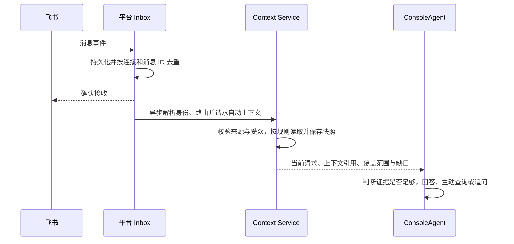

# Weora 飞书上下文第一版设计

- 状态：设计草案
- 日期：2026-10-17
- 2026-11-03 增量：显式 @ 的同话题/引用消息可续接 Task，活跃 Run 期间排队；`/new ` 可显式新建任务。普通消息自动触发仍未实现，见[本轮架构决策](../adr/0015-task-continuations.md)与验收记录（内部记录已移除）。下文保留首版设计背景。
- 上位架构：[研发 Agent 与飞书上下文](../architecture/agent-platform-and-feishu-context.md)
- 开发任务：[第一版开发计划](../development/weora-v0.1-implementation-plan.md)

## 1. 用户场景与范围

| 场景 | 用户行为 | 预期结果 |
| --- | --- | --- |
| S1 当前讨论补齐 | 在群里引用消息或回复话题，`@Weora 按刚才的登录方案处理` | 平台先补引用和当前讨论，Agent 理解约定；证据不足时追问 |
| S2 项目历史查询 | 在 Console 或飞书要求“查项目群上周的登录方案” | Agent 在获授权来源内按时间分页、展开话题，给出可追踪引用和遗漏说明 |
| S3 上下文驱动研发 | 用户审核方案并批准执行 | SandboxAgent 沿用同一 Run 的来源边界，补充证据后改码与验证 |
| S4 管理与撤权 | 管理员撤销来源或成员访问 | 后续读取、历史预览、恢复与交付立即执行新的授权规则 |

第一版支持中国大陆飞书企业自建应用机器人，采用应用身份访问；不提供用户 OAuth，不宣称自动继承个人在飞书里的全部可见范围。管理员在 Weora 中显式配置来源及读者，并对授权负责。

不包含全群持续归档、向量库、跨全公司关键词搜索、图片 OCR、附件正文解析、跨租户共享和完整 Project 领域。使用轻量 `ContextCollection` 组织“项目群”，一个集合只保存名称、来源关系和管理信息；加入集合不自动授予成员读取所有来源的权限。

借鉴 HiFox 的能力分层，但不增加第一版范围：渠道路由、用户关联、工具授权与通知交付分别管理。仍只使用应用身份与现有四个查询工具；个人 OAuth、扫码绑定、完整话题双向同步、关键词搜索、飞书 MCP、链接预览卡片、独立个人通知和新增消息触发方式均后置。参考证据及取舍见[架构中的 HiFox 参考设计](../architecture/agent-platform-and-feishu-context.md)。

## 2. 连接和来源授权

连接保存应用标识、加密凭据引用、工作空间和能力状态。后台管理 `tenant_access_token` 生命周期，凭据与 token 不进入前端响应、模型上下文或普通日志。

来源表示一个受管群聊；话题是来源内部的定位信息。管理员填写或选择群 ID，后台探测机器人入群状态和实际历史读取能力。界面分别显示“连接正常”“事件接收正常”“历史消息可读”，不能用收到一次 @ 消息证明所有能力正常。

应用身份读取群历史需要相应消息读取权限及群消息权限，实际开放范围以[飞书获取会话历史消息文档](https://open.feishu.cn/document/uAjLw4CM/ukTMukTMukTM/reference/im-v1/message/list)及应用后台审批为准。第一版联调必须验证 `im:message` 或适用的只读权限，以及 `im:message.group_msg` 等所需权限；缺权限时显示具体原因，不能伪装成“没有历史消息”。

权限执行规则：

1. 连接、来源、成员、Task 和 Run 必须属于同一工作空间。身份按 `connection_id + open_id` 绑定已验证的 Weora 成员，不按显示名自动匹配；未知或停用成员不能启动读取。
2. 可读范围为应用能力、来源授权、发起人授权、Run 授权和输出受众许可的交集。管理员设置来源读者时，明确其为 Weora 授权，而非已核验的飞书个人成员权限。
3. 飞书群 A 发起的 Run 第一版只读取 A 中获授权的内容；不自动查私有群 B 再发回 A。Console 私有 Run 可选本人获授权的多个来源，输出只能回到该私有受众。
4. Run 创建后不能扩大受众。共享、导出、通知和产物链接受同一规则约束；派生结论继承已读来源限制，不依赖模型自行删密。第一版不提供私有跨源答案的一键公开分享。
5. 每次调用、缓存命中、预览和恢复重新验证成员及来源授权。撤权后禁止继续查看相关快照和派生内容；已发送至飞书或已被外部模型接收的内容不能保证召回。

历史消息中的作者不必是 Weora 成员，可保留连接内外部作者标识和显示名；这不授予其触发或读取权限，也不新增外部账号中心。发起读取的用户仍必须完成已有的成员绑定和来源授权。第一版不根据作者姓名或邮箱自动关联成员。

## 3. 自动补齐当前讨论

这是模型调用前的平台代码流程，不需要 Agent 决定是否调用工具。

[打开离线 HTML](../architecture/diagrams/feishu-context.html) · [图表来源与绘制说明](../architecture/diagrams/README.md)

图中同时对比自动与主动两条读取路径，主动查询的工具契约见第 4 节。自动补齐的持久接收、确认与调用顺序如下。

展开自动补齐的调用顺序参考

默认策略为可配置产品初值，而非飞书接口保证：

| 项目 | 第一版默认值与行为 |
| --- | --- |
| 时间截止 | 触发消息时间；不把随后出现的消息混入“当时的讨论” |
| 读取窗口 | 最近 2 小时；明确引用的旧消息允许单独读取并标注时间 |
| 消息预算 | 最多纳入 10 条唯一上下文消息，不含当前请求；所有分支共享预算 |
| 总耗时 | 自动补齐总截止时间 3 秒，超时保留已取得内容和缺口 |
| 输入预算 | 自动上下文约 2,000 tokens；按实际模型 tokenizer 或保守估算截断并标记 |
| 优先级 | 当前请求单独保留；上下文依次优先明确引用、同话题、群内邻近消息 |

先去重、过滤时间、核验群和话题，再按优先级选择，最终按时间排序展示。同话题读取失败时不得悄悄退化为整群消息；整群邻近消息仅作为显式启用的独立补充，不能冒充完整话题。跨群引用默认不展开。链接、富文本和不支持内容转为明确占位信息，不偷偷下载附件。

自动补齐通过 Context Service 的应用接口调用 FeishuReader，与按需工具共享鉴权、分页、规范化及快照实现，但不额外消耗 Agent 的 Tool Calling 轮次。自动补齐也受独立的读取与耗时预算约束。

结果不足以支持咨询结论时说明限制；如果用户要求“按刚才约定改代码”，而关键约定缺失或冲突，必须先等待补充，不能将局部历史当成完整需求执行。

## 4. Agent 主动查询历史

Agent 决定“查哪些来源、哪个时间段、要不要下一页、要不要展开某个话题”。Tool Gateway 校验参数与权限，Context Service 执行实际读取。ConsoleAgent、SandboxAgent 均可调用，但只继承当前 Run 已授予的权限，角色切换不自动加权。

| 工具 | Agent 可提供的参数 | 确定性行为 |
| --- | --- | --- |
| `context.sources.list` | 可选集合筛选 | 返回当前 Run 与受众内可用来源；不列出未授权群的名称 |
| `feishu.messages.list` | `source_id, start_time, end_time, cursor, limit` | 在指定来源和窗口内分页读取消息 |
| `feishu.thread.read` | `source_id, thread_id, cursor, limit` | 验证话题归属来源，展开话题并执行本地时间过滤 |
| `feishu.message.get` | `source_id, message_id` | 返回指定消息；验证返回群与授权来源一致 |

工作空间、发起人、调用角色、Run、凭据和实际权限由服务端注入，模型不能指定。消息与话题 ID 即使可猜中，也不能绕过来源校验。工具不开放任意 URL 请求或原始飞书 API 代理。

FeishuReader 可以在后台采用 SDK/API 或经过验证的官方 CLI，第一版只需一种实现，不新增任意命令工具。必须使用连接对应的应用身份；缺失、失效或冲突凭据明确报错，不借用开发者个人登录态。无论底层实现如何，来源授权、预算、快照与受众约束保持不变。

例如“查项目群上周的登录方案”：平台确定 Run 时区与截止点，Agent 发现获授权项目集合，选择上周窗口读取；看到有关登录的消息后展开其话题，按预算继续分页，最后区分“已找到的约定”和“尚未覆盖的范围”。如果来源多义，先询问，不默认扫描所有群。

### 4.1 时间、分页与预算

| 项目 | 默认值或上限 |
| --- | --- |
| 未指明时间 | 最近 7 天，Agent 可在授权与预算内缩小或调整 |
| 单次窗口 | 最多 30 天；范围过大返回参数错误，不静默缩小 |
| 单页 | 默认 30 条，最多 50 条 |
| 主动内容调用 | 每 Run 最多 10 次，包含失败尝试，防止无限重试 |
| 主动消息数量 | 每 Run 最多交付 300 条唯一消息 |
| 上下文输入 | 飞书自动与主动内容累计最多约 12,000 tokens，达到后返回明确预算状态 |

预算由服务端统一计数，自动预算之外不得靠多角色绕过 Run 总量；来源发现另设频率限制。以上是第一版可调初值，需要用真实群消息密度调优。

“上周”等自然语言按工作空间时区解释，界面显示明确起止时间；内部使用 UTC。默认 `end_time` 固定为 Run 开始时刻，后续分页不混入新消息。显式刷新应创建新的查询快照，并标明更新时间，不改写旧证据。

游标采用服务端签名的不透明值，绑定 Run、调用主体、来源、查询窗口、排序、授权版本及过期时间。下一页必须匹配查询，且重新授权。不能把飞书 `page_token` 原样作为可跨 Run 使用的凭证。

飞书会话历史接口支持分页；话题读取的时间过滤能力不同，Adapter 应在本地过滤并保存必要的遍历状态。若一页内只返回部分消息，游标必须保留未交付的位置，不能把上游整页游标直接推进导致丢消息。达到扫描预算时标记 partial，不能把“本页过滤后为空”当成已查完。

### 4.2 返回与引用契约

所有内容工具返回统一结果：

- `status`：`complete`、`partial` 或 `unavailable`。
- `source_id`、`snapshot_id`、查询窗口、`fetched_at`：说明来自哪里、哪次读取及抓取时间。
- `messages`：每条保存稳定 `ref`、消息 ID、话题 ID、作者、发送时间、规范化正文及必要的内容类型。
- `next_cursor`：仅在可继续遍历时提供；预算耗尽时同时说明能否通过新请求继续。
- `coverage`：包括 `window_complete`、`truncated`、`reason`，区分 `has_more`、`budget_exceeded`、`timeout`、`unsupported_content` 等情况。
- `error`：机器可读错误码及安全的用户提示，区分 `PERMISSION_DENIED`、`SOURCE_REVOKED`、`RATE_LIMITED`、`PROVIDER_UNAVAILABLE`、`INVALID_CURSOR`、`CONTEXT_EXPIRED`。

有后续页时状态为 partial，窗口完整性为 false。只有请求范围遍历结束且没有遗漏时，才对该请求标记 complete；单消息 get 的 complete 仅代表那条消息成功取得。遍历完成不证明“所有登录方案都找到了”，相关性判断仍属于 Agent。

界面根据 `ref` 打开受权限控制的快照详情。仅当 Adapter 能提供已验证的飞书跳转链接时展示“在飞书打开”；否则展示消息 ID 和引用预览，不拼造未经验证的 deep link。模型不能伪造引用：平台校验引用是否来自本 Run 已交付的快照。

### 4.3 消息解析与图片、附件的能力边界

2026-10-19补齐接收消息解析；依据[飞书官方接收消息内容结构](https://open.feishu.cn/document/server-docs/im-v1/message-content-description/message_content.md)，不把发送JSON当成接收JSON。此改动属于W04的规范化与覆盖事实，不增加OCR、附件正文解析或新的群任务触发方式。

| 内容 | 第一版处理 | 不代表什么 |
| --- | --- | --- |
| 文本 | 读取正文 | 不提升正文中的指令权限 |
| 富文本post | 提取已知标题、正文、提及、链接；优先content_v2 | 不执行HTML、不访问链接、不忽略未知节点 |
| 系统消息 | 解析官方模板及明确变量；缺失/未知变量保留缺口 | 不把全部系统消息无条件视为可忽略 |
| 接收卡片 | 提取默认接收结构内的已知文字；按钮仅保留标签 | 不点击按钮，不取得卡片交互后的动态内容 |
| 图片、文件、文件夹、音视频、表情 | 记录类型和可用的白名单资源信息 | 未下载、未OCR、未读懂图片/附件正文 |
| 撤回或未知消息 | 明确撤回/不支持，不恢复旧正文或猜测内容 | 不保证从飞书恢复已经不可见的内容 |

消息保留真实`content_type`，增加可选`parse_status`（`complete/partial/unsupported/recalled`）、稳定原因码`parse_notes`及`resources`。资源仅包含适用的`image_key/file_key/file_name/duration`，`duration`单位毫秒；当前`downloaded=false`、`parsed=false`。界面只展示普通文字，不把资源标识拼成URL或自动加载外部图片。

快照是否完整按实际解析事实判断，而不是简单判断`content_type == text`。包含资源、未知节点、截断或未执行交互时保留partial；查询分页/超时缺口另行保留。资源信息和备注也计入同一Run输入预算，并随消息一起受来源权限、撤权和正文TTL约束。旧持久快照与旧回答不回写、不升级；重新读取会生成新证据。

图片和附件后续可以理解内容，但属于第二层能力，当前尚未实现。应按以下边界接入，而不是让Agent自行访问任意下载地址：

1. Agent用既有消息工具发现资源，按本Run的消息引用与资源位置提出读取请求，不能仅凭任意`file_key`或URL下载。
2. 平台重新校验成员、来源、受众、消息归属和时效；限制文件类型、真实大小、数量、超时与累计预算，拒绝危险归档、宏与可执行内容。
3. Tool通过固定飞书资源API、平台应用身份受控下载，不把token交给Agent，不跟随任意重定向。
4. 图片交给明确启用的OCR/视觉解析能力，PDF/Office等交给隔离的文档解析器；未启用、不支持、扫描件或解析失败均给明确状态。
5. 提取结果保存来源引用、处理方式及缺口，继承源权限和保留期；只有允许外发的内容才能交给配置的模型供应商。
6. Agent依据真实提取结果回答，不能把“发现资源”或“下载成功”说成“理解完整”。

当前`TextRuntime`协议只传文本，不因拿到`image_key`或截图Base64就具备视觉能力。可先由受控OCR/文档解析生成文本；若接入原图理解，必须另行定义Runtime多模态能力和供应商授权策略。本轮不新增资源下载Tool，也不默认把飞书图片或附件发送给模型。

群入口本轮仍仅接受显式文本`@`；读取历史中的post/图片/文件，不等于它们已经成为新的任务触发方式。

## 5. 数据与可靠性

| 数据 | 归属 | 核心约束 |
| --- | --- | --- |
| FeishuConnection | channels | 工作空间内连接；凭据只存安全引用，禁用可中止后续访问 |
| FeishuIdentityBinding | channels | `connection_id + open_id` 唯一；绑定有效成员 |
| ContextSource 与 SourceGrant | context | 来源按工作空间、连接、群 ID 唯一；授权可撤销并版本化 |
| ContextCollection 与来源关系 | context | 轻量项目来源分组；不隐式扩大权限 |
| InboundEvent | channels | 原始事件接收记录；按事件键去重，消息处理再以连接及消息 ID 保证唯一任务 |
| ConversationBinding | channels | 工作空间、连接、群、话题与 Agent 路由；显式保存单聊或无话题维度 |
| ContextSnapshot | context | 保存返回内容、校验摘要、来源限制、窗口和覆盖状态；绑定 Run |
| ToolInvocation 与 RunEvent | tools 与 runs | 调用请求、结果引用、状态和时序；日志与通用事件避免复制消息正文 |
| DeliveryOutbox | channels | 交付对象、目的受众、幂等业务键、发送尝试和远端消息 ID |

Task 保存来源连接、群、可空话题及触发消息 ID，与 ConversationBinding 的 Agent 路由区分；Outbox 使用相应原会话目标。第一版不新增独立 TaskThreadBinding 管理和持续评论同步，普通话题新消息不自动启动 Run，也不改写活跃 Run 或已批准计划。回报过滤机器人自身消息并关联远端发送 ID，避免触发循环；后续显式请求仍走现有去重和上下文流程。

连接进程只负责连接生命周期与可靠接收，不在确认接收前调用模型或补齐历史。Inbox 提交成功后才确认；存储失败不确认，并验证飞书重投与重连行为。消息编辑、撤回不能当作新的用户指令重复启动 Run；第一版记录变化，后续引用显示已知变更，不承诺获得所有历史变化事件。

Worker 原子领取、租约、重试次数和失败原因均持久化。创建 Task/Run 与提交待调度记录在同一事务内，通过 Outbox 投递至 Celery；定期扫描未投递记录，避免数据库成功而队列丢失。出站未知结果先核对、再决定重试，允许显示“投递结果待确认”，不能靠重复消息掩盖不确定性。

快照正文默认保留 7 天，可由工作空间缩短或配置；审计保留策略独立且不含正文。正文 TTL 同样覆盖内容缓存、上下文检查点、带正文的模型消息与衍生预览，不能只删快照主表而在事件里永久保留副本。含原文的报告与摘要继承来源权限及相应内容保留策略。过期后仅保留可审计的 ID、摘要值和状态，界面显示“内容已过期”，不保证无限期恢复上下文。

撤权先同步禁止访问，再异步清理缓存及派生副本。模型供应商侧数据保留另按工作空间的模型配置与合同约束，Weora 本地删除不等于远端数据已删除。

## 6. 第一版界面

1. **连接设置**：配置应用、验证连接、查看事件与历史读取能力、配置已验证的成员绑定；密钥只允许覆盖更新，不提供明文回显。
2. **上下文来源**：来源授权、读者、项目集合、探测结果和撤权。配置仅管理员可见，普通用户只看到本人允许使用的来源。
3. **任务入口**：Console 中选择来源与时间范围；飞书自动确定当前群。显示查询受众，不能在创建后扩大。
4. **Run 详情**：区分自动补齐与主动 Tool 调用，查看覆盖范围、引用、缺口、等待状态及投递失败。引用预览再次鉴权。

沿用当前 Web 共享组件与 Semi 交互习惯，先复用再扩展；可以参考 Multica 的信息布局，独立编写实现，不复制上游前端源码或品牌。

## 7. 参考来源与采用结论

飞书接口能力以[官方历史消息接口](https://open.feishu.cn/document/uAjLw4CM/ukTMukTMukTM/reference/im-v1/message/list)为准，真实应用开通与联调属于开发验收。

Multica 参考固定在 commit `6d5cdcbed2a7c7ace3f31d54fd23b20284c3bc55`，不代表未来版本：

| 参考位置 | Weora 的采用结论 |
| --- | --- |
| [inbound_enricher.go](https://github.com/multica-ai/multica/blob/6d5cdcbed2a7c7ace3f31d54fd23b20284c3bc55/server/internal/integrations/lark/inbound_enricher.go) | 参考引用与话题补齐、失败标记；Weora 改为持久接收后异步装配 |
| [client.go](https://github.com/multica-ai/multica/blob/6d5cdcbed2a7c7ace3f31d54fd23b20284c3bc55/server/internal/integrations/lark/client.go) | 参考客户端封装边界；Weora 独立实现时间窗口、连续分页和覆盖状态 |
| [chat_history.go](https://github.com/multica-ai/multica/blob/6d5cdcbed2a7c7ace3f31d54fd23b20284c3bc55/server/internal/handler/chat_history.go) | 区分已保存的会话记录与平台历史读取；不能把本地会话历史等同于飞书任意群历史工具 |

仅采用能力分层与行为取舍，自主定义模型、接口和测试，不直接移植上游实现。
