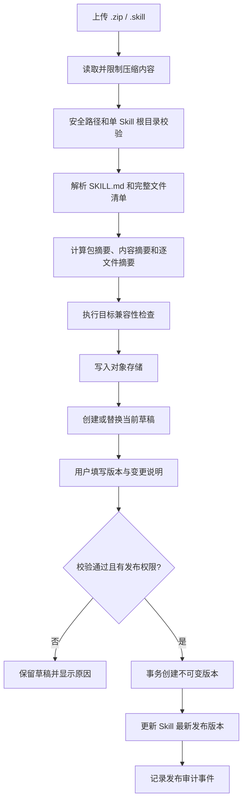
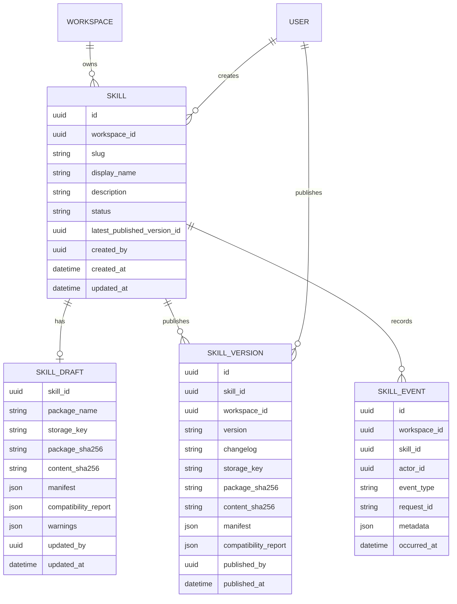

# Weora Skill Registry v0.1 设计方案

## 文档信息

- 状态：已确认并实现
- 版本：v0.1
- 日期：2026-08-22
- 适用范围：团队 Skill 资产的上传、校验、草稿、发布、版本历史与下载
- 不包含：Runtime 自动安装、公开市场、在线编辑器、审批流

### 实现落点与验证状态

- 后端领域：`backend/src/weora/modules/skills/`，按 Domain、Application、Infrastructure、API 分层。
- 数据迁移：`backend/migrations/versions/20260822_0002_create_skill_registry_tables.py`。
- Web 交互：`apps/web/src/features/skills/`，覆盖列表、上传、详情、发布、版本和活动记录。
- 自动化验证：包安全单测、HTTP 契约测试、真实阿里云 OSS 集成测试、Web 单测与构建均通过。
- 浏览器验收：真实完成注册、上传、连续发布 `0.1.0` / `0.1.1`、分别下载和归档内容核对。
- 环境说明：PostgreSQL DDL 已通过 Alembic 离线编译，SQLite 已真实执行到 migration head；本机 PostgreSQL 因开发环境密码不匹配，尚未执行在线迁移。
- 首版列表支持关键词、状态和不透明游标分页；兼容目标筛选与“最近更新人”列延后到兼容报告真正产生区分度后实现。

## 1. 结论

Weora 第一版 Skill Registry 应当把 Skill 设计成**工作空间拥有的独立组织资产**，而不是某个 Agent 的附件。

第一版完成以下闭环：

1. 工作空间成员上传 `.zip` 或 `.skill` 包。
2. 平台校验并规范化完整 Skill 目录。
3. 平台展示解析结果、文件清单、兼容性和风险提示。
4. 有权限的成员填写语义化版本与变更说明并发布。
5. 已发布版本保持不可变，其他成员可以查看、下载和校验。
6. 所有读取、写入和审计记录都绑定 `workspace_id`。

该方案参考：

- Dify 的 Skill 包校验、规范化、上传交互与 Agent 使用方式。
- Coze Studio 的空间隔离、草稿、版本、发布和历史记录。

Weora 不直接复制两者。它的核心差异是：

> 一份 Skill 先成为组织资产，再由不同 Agent、成员和 Runtime 引用或分发。

## 2. Problem Statement

团队成员已经在 Codex、Claude Code、Dify Agent 等不同 Runtime 中积累 Skill，但目前通常通过 Git 仓库、压缩包或聊天工具人工传递，存在以下问题：

- Skill 与某个使用者或 Runtime 绑定，其他成员难以发现和复用。
- 团队无法确认安装的是哪个版本、内容是否完整、是否被修改。
- `SKILL.md` 之外的 `agents/`、`references/`、`scripts/` 和资源文件容易在分享时丢失。
- Skill 更新后需要人工通知，缺少版本历史、变更说明和回滚依据。
- 不同 Runtime 的目录、元数据和兼容规则不同，非技术成员难以判断能否使用。
- Skill 包可能包含危险路径、超大压缩内容或敏感信息，直接解压存在安全风险。
- Skill 一旦被 Agent 使用，团队无法追踪具体引用和分发版本。

如果只把 Skill 作为某个 Agent 的上传附件，就无法解决组织资产沉淀问题；如果第一版直接实现市场、自动安装和复杂审批，又会过早扩大范围。

## 3. Solution

建设工作空间级 Skill Registry，将完整 Skill 目录封装成可校验、可版本化、可发布和可下载的组织资产。

### 3.1 产品边界

Skill Registry 负责：

- Skill 的稳定身份和工作空间归属。
- 完整 Skill 包的安全校验与规范化。
- 当前草稿和不可变发布版本。
- 内容校验值、文件清单和兼容性报告。
- 版本历史、下载和关键状态审计。

Skill Registry 暂不负责：

- 执行 Skill。
- 自动信任或运行包内脚本。
- 代替 Agent Runtime 解释 `SKILL.md`。
- 直接管理模型、工具凭据或环境变量值。
- 第一版自动安装到成员本机。

### 3.2 核心原则

1. **资产独立**：Skill 不依附某个 Agent，Agent 以后通过不可变版本 ID 引用 Skill。
2. **完整目录**：分发单元是完整目录，不是单独的 `SKILL.md`。
3. **发布不可变**：发布后内容、版本号、校验值和兼容性结果不能修改。
4. **工作空间隔离**：所有查询和写入必须带上并验证 `workspace_id`。
5. **只校验不执行**：上传阶段不会导入模块、运行脚本或执行包内命令。
6. **数据库存元数据，对象存储存内容**：PostgreSQL 是业务状态来源，S3 是包内容来源。
7. **显式兼容**：兼容性由目标适配器验证，不能因为存在 `SKILL.md` 就声称兼容所有 Runtime。

## 4. 上游源码参考与采用结论

### 4.1 参考快照

| 项目 | Commit | 参考范围 |
| --- | --- | --- |
| [Dify](https://github.com/langgenius/dify/tree/8cca3959aeae9063be13b167ddd43929fbc10d92) | `8cca3959aeae9063be13b167ddd43929fbc10d92` | Agent v2 Skill 包、Agent Drive、上传交互 |
| [Coze Studio](https://github.com/coze-dev/coze-studio/tree/fefb05ff27be1da939612fbf9faf5db62583b8ae) | `fefb05ff27be1da939612fbf9faf5db62583b8ae` | Plugin 草稿、版本、发布、空间资源和发布 UI |

### 4.2 Dify

| 参考位置 | 观察 | Weora 结论 |
| --- | --- | --- |
| `api/services/agent/skill_package_service.py` | 接受 `.zip` / `.skill`，要求 `SKILL.md`，限制大小和条目数，防止路径穿越，解析元数据并计算哈希 | 采用安全校验与规范化思路；增加稳定的内容校验值和逐文件摘要 |
| `api/services/agent/skill_standardize_service.py` | 将 Skill 规范化为 `SKILL.md` 和完整归档，并写入单个 Agent Drive | 采用“保留完整归档、按需查看文件”的思路；不采用 Agent 私有所有权 |
| `api/models/agent.py::AgentDriveFile` | Skill 数据按 `tenant_id + agent_id` 隔离 | 改为 `workspace_id + skill_id`，使 Skill 成为工作空间资产 |
| `api/models/agent_config_entities.py::AgentConfigSkillRefConfig` | Agent 配置通过文件 ID、哈希和元数据引用 Skill | 后续 Agent 必须通过 `skill_version_id` 引用，不能复制可变草稿 |
| `api/controllers/console/app/agent.py` | 上传、删除和工具推断接口都位于 Agent 路径下 | 不采用 Agent 路径；Skill Registry 提供独立工作空间 API |
| `web/.../skills/upload-dialog.tsx` | 单文件拖拽上传、扩展名限制、错误提示和上传成功反馈清晰 | 采用简洁上传交互，并增加校验报告和发布步骤 |

### 4.3 Coze Studio

| 参考位置 | 观察 | Weora 结论 |
| --- | --- | --- |
| `backend/domain/plugin/service/service.go` | 明确区分 Draft、Online、Version 和 Agent Tool | 采用草稿、发布版本和后续引用的边界 |
| `backend/domain/plugin/service/plugin_release.go` | 发布前检查调试状态和版本递增 | Skill 发布前必须通过包校验，版本必须满足 SemVer 且不能重复 |
| `backend/domain/plugin/repository/plugin_impl.go` | 在线版本、历史版本及关联 Tool 在一个事务中发布 | Skill 元数据、版本快照、最新版本指针和审计事件在一个数据库事务中提交 |
| `backend/domain/plugin/internal/dal/plugin_draft.go` | 草稿与已发布实体分开保存 | 采用单独的 Skill Draft，避免误改已发布版本 |
| `backend/domain/plugin/internal/dal/plugin_version.go` | 独立保存版本历史并支持分页查询 | 采用不可变 Skill Version 和版本历史列表 |
| `frontend/packages/studio/plugin-publish-ui-adapter/src/components/plugin-publish-ui/base.tsx` | 发布入口保持紧凑，只在需要时展开版本表单 | 采用轻量发布弹窗，避免把详情页变成多步向导 |
| `frontend/packages/studio/plugin-publish-ui-adapter/src/components/plugin-publish-ui/version-description-form.tsx` | 发布时填写版本号和版本说明 | 采用建议下一个 Patch 版本和必填变更说明 |
| `frontend/packages/studio/workspace/entry-base/src/pages/library/index.tsx` | 空间资产页统一承载检索、筛选和创建入口 | 采用工作空间资产列表的信息架构 |
| `frontend/packages/studio/workspace/entry-base/src/pages/library/components/base-library-item.tsx` | 资源列表使用紧凑条目承载身份、状态与操作 | 采用低噪声资产表格，不复制其代码与视觉品牌 |

### 4.4 明确不采用

- 不复制 Dify 的业务源码、数据模型或 Agent Drive 表。
- 不把 Skill 文件复制到每个 Agent 的私有目录中作为权威来源。
- 不沿用 Coze 将插件、工作流和知识库统称为 Skill 的领域语言。
- 不在 v0.1 建设公开市场、商品、评分或推荐系统。
- 不使用上游实现替代 Weora 的权限、审计和工作空间决策。

## 5. User Stories

1. 作为工作空间 Owner，我希望上传完整 Skill 包，以便把个人能力沉淀为团队资产。
2. 作为 Skill 作者，我希望平台自动读取名称和描述，以减少重复填写。
3. 作为 Skill 作者，我希望看到完整文件清单，以确认辅助脚本和参考资料没有丢失。
4. 作为 Skill 作者，我希望上传失败时看到明确错误，以便快速修复包结构。
5. 作为 Skill 作者，我希望看到安全警告，以免误发布密钥或危险文件。
6. 作为 Skill 作者，我希望先保存草稿，以便校验和补充发布信息。
7. 作为发布者，我希望填写 SemVer 和变更说明，以便团队理解版本变化。
8. 作为发布者，我希望平台建议下一个 Patch 版本，以减少版本号输入成本。
9. 作为发布者，我希望发布前看到最终摘要，以确认版本、校验值和兼容目标。
10. 作为工作空间成员，我希望浏览和搜索团队 Skill，以便发现可复用能力。
11. 作为工作空间成员，我希望按发布状态和兼容目标筛选，以便找到适合当前 Runtime 的版本。
12. 作为工作空间成员，我希望查看 Skill 详情和使用说明，以便判断是否适合当前任务。
13. 作为工作空间成员，我希望查看版本历史，以便选择稳定版本或了解变更。
14. 作为工作空间成员，我希望下载完整发布包，以便安装到目标 Runtime。
15. 作为工作空间成员，我希望校验下载内容，以确认文件没有损坏或被替换。
16. 作为管理员，我希望归档不再维护的 Skill，同时保留历史版本和审计记录。
17. 作为管理员，我希望非成员无法探测 Skill 是否存在，以保护工作空间资产。
18. 作为审计人员，我希望发布和归档事件关联用户、工作空间和请求，以便追溯重要操作。
19. 作为后续 Agent 模块，我希望通过不可变版本 ID 引用 Skill，以确保运行可复现。
20. 作为后续 Runtime Adapter，我希望获得标准化包和兼容性报告，以便安全地生成目标安装产物。

## 6. 用户体验设计

### 6.1 信息架构

```text
Skills
├── Skill 列表
│   ├── 搜索
│   ├── 状态筛选
│   └── 兼容目标筛选
├── 上传 Skill
│   ├── 选择或拖拽包
│   ├── 校验结果
│   └── 创建草稿
└── Skill 详情
    ├── 概览
    ├── 当前草稿
    ├── 版本历史
    ├── 文件清单
    ├── 兼容性
    └── 活动记录
```

### 6.2 Skill 列表

列表延续当前 Weora 与 Dify 登录页确定的简洁基调，优先使用信息密度适中的表格或列表，不在第一版使用市场卡片瀑布流。

每行展示：

- Skill 名称和描述。
- 当前状态：仅草稿、已发布、已归档。
- 最新发布版本。
- 兼容目标。
- 最近更新人和更新时间。
- 快捷操作：打开、上传新草稿。

空状态提供单一主操作“上传第一个 Skill”，不展示虚假示例数据。

### 6.3 上传与校验

上传弹窗参考 Dify 的单包拖拽交互，但分为三个可理解阶段：

1. **选择文件**：仅接受一个 `.zip` 或 `.skill`。
2. **校验内容**：展示名称、描述、文件数量、总大小、内容校验值、兼容性和警告。
3. **创建草稿**：确认后进入 Skill 详情页。

错误分为：

- 阻断错误：不能创建草稿，例如缺少 `SKILL.md`、危险路径、压缩包损坏。
- 发布阻断：可以查看草稿但不能发布，例如缺少必填元数据。
- 警告：允许发布但需要明确确认，例如检测到可能的敏感文件名。

### 6.4 Skill 详情

详情页顶部展示：

- 显示名称、包内名称和状态。
- 最新发布版本。
- 内容校验值短值。
- 兼容目标标签。
- “上传新草稿”或“发布”主操作。

文件页只做只读预览：

- 展示目录树、文件大小和逐文件 SHA-256。
- `SKILL.md` 允许文本预览。
- 其他文本文件按大小和类型限制预览。
- 二进制文件只展示元数据，不在浏览器执行或解析。

### 6.5 发布

发布面板参考 Coze 的版本发布体验：

- 默认建议 `0.1.0`，后续建议增加 Patch 版本。
- 版本号必须符合 SemVer，不保存 `v` 前缀。
- 变更说明必填，最大 800 字。
- 展示包内容校验值、兼容目标和未解决警告。
- 发布成功后进入不可变版本详情。

## 7. 核心流程



### 7.1 失败处理

- 校验失败前不创建数据库记录，也不写对象存储。
- 对象存储写入失败时不创建草稿。
- 对象写入成功但数据库事务失败时，执行尽力清理，并记录结构化错误供孤儿对象清理任务处理。
- 发布事务失败时，草稿保持原状态，不产生部分版本。
- 下载时如果数据库版本存在但对象缺失，返回明确的资产损坏错误并记录告警。

## 8. Implementation Decisions

### 8.1 领域模型



### 8.2 主要不变量

- `Skill.workspace_id + slug` 唯一。
- 一个 Skill 最多只有一个当前草稿。
- `SkillVersion.skill_id + version` 唯一。
- Skill Version 创建后禁止更新和删除。
- `latest_published_version_id` 必须指向同一 Skill 的已发布版本。
- 草稿包和发布版本都必须保存完整校验报告。
- 发布使用的对象内容必须与草稿 `content_sha256` 一致。
- 已归档 Skill 禁止发布新版本，但历史版本仍可查看和下载。
- 非当前工作空间成员访问时返回 404，避免暴露资源存在性。

### 8.3 状态模型

Skill 状态：

```text
ACTIVE -> ARCHIVED
ARCHIVED -> ACTIVE
```

版本不是可变状态机：

```text
SkillDraft --publish--> SkillVersion
```

发布不是把草稿记录改成“已发布”，而是从草稿生成不可变快照。发布后可以保留同内容草稿，也可以清空当前草稿；v0.1 选择清空草稿，下一次上传重新创建。

### 8.4 包格式

支持：

- `.zip`
- `.skill`，内容仍为 ZIP

包必须：

- 包含且只包含一个 Skill 根目录。
- 根目录包含 UTF-8 编码的 `SKILL.md`。
- `SKILL.md` YAML Frontmatter 包含非空 `name` 和 `description`。
- 保留 `agents/`、`references/`、`scripts/`、`assets/` 及其他安全文件。

默认限制：

- 压缩包最大 50 MB，可配置。
- 解压后总大小最大 200 MB。
- 文件条目最多 5,000 个。
- `SKILL.md` 最大 1 MB。
- 单个可预览文本文件最大 512 KB。

拒绝：

- 绝对路径、`..`、反斜杠混用和空字节路径。
- 规范化后重复路径。
- 符号链接和特殊设备文件。
- 多个候选 Skill 根目录。
- 加密 ZIP。
- 损坏或无法完整读取的成员。

平台会重建确定性归档，移除 ZIP 时间戳等不稳定元数据，并保存：

- `package_sha256`：最终下载包的 SHA-256。
- `content_sha256`：按排序后的路径与逐文件摘要计算，与 ZIP 元数据无关。
- `files[]`：路径、大小、媒体类型和逐文件 SHA-256。

### 8.5 深模块

#### SkillPackageInspector

纯业务输入输出模块，负责：

- 限制和读取 ZIP。
- 根目录选择与安全路径校验。
- `SKILL.md` 解析。
- 确定性归档。
- 文件清单与校验值。
- 风险警告。

它不访问数据库、对象存储、FastAPI 或 Runtime。

#### SkillCompatibilityEvaluator

通过目标适配器生成结构化兼容报告：

- `generic_agent_skill`
- `codex`
- `claude_code`
- `dify_agent`

每个结果只能是：

- `compatible`
- `compatible_with_warnings`
- `incompatible`
- `not_evaluated`

v0.1 只报告静态包兼容性，不声称已经在真实 Runtime 中安装或运行成功。

#### SkillRegistryService

表达创建草稿、替换草稿、发布、归档、查询和下载等用例，负责：

- 工作空间权限。
- Repository 和对象存储编排。
- 事务边界。
- 审计事件。
- 外部错误转换。

#### SkillRepository

保证所有聚合查询都携带 `workspace_id`，保存 Skill、草稿、版本和事件。

#### ObjectStoragePort

使用 [`ADR-0002`](../adr/0002-provider-neutral-object-storage.md) 定义的异步对象存储端口。
OSS、AWS S3、MinIO、Endpoint、Bucket、签名和 SDK 异常不能进入 Domain。

### 8.6 对象存储

- 第一阶段使用阿里云 OSS 官方 Python SDK V2 Adapter。
- 对象存储由统一 Port 和启动工厂装配；后续 AWS S3、MinIO 或其他兼容服务通过
  `S3CompatibleObjectStorage` 接入，并在契约测试通过后开放对应 Provider 配置。
- 本期不在 Docker Compose 中增加 MinIO；本地开发使用测试 OSS Bucket 或显式禁用对象存储功能。
- 对象键不包含用户提供的原始文件名，避免路径和编码问题。
- 推荐对象键：

```text
skills/{workspace_id}/{skill_id}/draft/{content_sha256}.skill
skills/{workspace_id}/{skill_id}/versions/{version}/{content_sha256}.skill
```

- v0.1 发布时将草稿对象复制到版本专属键，并重新核对大小和应用 SHA-256。
- 草稿和发布版本不共享可变对象；后续确认存储量值得优化后，再设计内容寻址去重。
- 数据库保存对象键、大小和校验值，不保存包二进制。
- v0.1 下载由后端完成权限检查后流式返回；后续大规模使用时再改为短期签名 URL。

### 8.7 API 契约

所有 API 都以显式工作空间路径表达租户上下文。

| 方法 | 路径 | 用途 |
| --- | --- | --- |
| `GET` | `/workspaces/{workspace_id}/skills` | 分页、搜索和筛选 Skill |
| `POST` | `/workspaces/{workspace_id}/skills` | 上传包并创建 Skill 与初始草稿 |
| `GET` | `/workspaces/{workspace_id}/skills/{skill_id}` | 获取详情、当前草稿和最新版本摘要 |
| `PATCH` | `/workspaces/{workspace_id}/skills/{skill_id}` | 修改显示名称和描述 |
| `POST` | `/workspaces/{workspace_id}/skills/{skill_id}/draft` | 上传并替换当前草稿 |
| `GET` | `/workspaces/{workspace_id}/skills/{skill_id}/draft` | 获取草稿校验结果 |
| `POST` | `/workspaces/{workspace_id}/skills/{skill_id}/publish` | 以当前草稿发布不可变版本 |
| `GET` | `/workspaces/{workspace_id}/skills/{skill_id}/versions` | 获取版本历史 |
| `GET` | `/workspaces/{workspace_id}/skills/{skill_id}/versions/{version}` | 获取版本详情 |
| `GET` | `/workspaces/{workspace_id}/skills/{skill_id}/versions/{version}/download` | 下载完整发布包 |
| `POST` | `/workspaces/{workspace_id}/skills/{skill_id}/archive` | 归档 Skill |
| `POST` | `/workspaces/{workspace_id}/skills/{skill_id}/restore` | 恢复 Skill |
| `GET` | `/workspaces/{workspace_id}/skills/{skill_id}/events` | 获取关键活动记录 |

写接口继续使用当前 Cookie Session，并要求 CSRF Header。

统一错误码至少包括：

- `SKILL_PACKAGE_TOO_LARGE`
- `SKILL_ARCHIVE_INVALID`
- `SKILL_ARCHIVE_UNSAFE_PATH`
- `SKILL_ROOT_AMBIGUOUS`
- `SKILL_MANIFEST_MISSING`
- `SKILL_MANIFEST_INVALID`
- `SKILL_SLUG_CONFLICT`
- `SKILL_DRAFT_NOT_READY`
- `SKILL_VERSION_INVALID`
- `SKILL_VERSION_CONFLICT`
- `SKILL_ARCHIVED`
- `SKILL_OBJECT_MISSING`
- `WORKSPACE_ACCESS_DENIED`

### 8.8 权限

v0.1 按以下目标角色定义权限边界：

| 操作 | Owner | Admin | Member |
| --- | --- | --- | --- |
| 列表、查看、下载 | 是 | 是 | 是 |
| 创建和更新草稿 | 是 | 是 | 否 |
| 发布版本 | 是 | 是 | 否 |
| 归档和恢复 | 是 | 是 | 否 |
| 查看活动记录 | 是 | 是 | 是 |

当前 Identity 实现只会创建 Owner 成员关系，Admin 和 Member 的成员管理入口尚未实现。Skill Registry
仍应通过统一成员权限查询执行策略，不在 API 中写死“当前用户就是 Owner”；在成员邀请功能完成前，
产品界面实际只会走 Owner 路径。

### 8.9 安全

- 上传内容不执行、不导入、不渲染 HTML。
- 路径校验发生在任何解压写盘之前，优先在内存或隔离临时目录中处理。
- 临时目录由服务创建并在请求结束后清理。
- 识别私钥头、`.env`、常见凭据文件和高风险扩展名。
- 明确私钥内容作为发布阻断；其他可疑文件产生警告并要求发布者确认。
- 日志只记录 Skill ID、工作空间、错误码和大小，不记录文件正文或疑似凭据。
- 下载响应设置 `Content-Disposition: attachment` 和 `X-Content-Type-Options: nosniff`。
- 对象存储 Bucket 默认私有，禁止匿名读取。
- 上传接口按用户和工作空间限流。

### 8.10 审计与可观测

记录以下事件：

- `SKILL_CREATED`
- `SKILL_DRAFT_REPLACED`
- `SKILL_PUBLISHED`
- `SKILL_ARCHIVED`
- `SKILL_RESTORED`
- `SKILL_DOWNLOAD_REQUESTED`

事件至少包含：

- `request_id`
- `workspace_id`
- `skill_id`
- `actor_id`
- `version`
- `content_sha256`
- `occurred_at`

结构化日志关联 `request_id`、`workspace_id` 和 `skill_id`。对象存储调用记录耗时、结果和对象大小，不记录对象正文。

## 9. Testing Decisions

测试只验证外部行为和业务不变量，不断言私有方法调用次数或目录层数。

### 9.1 Domain / 纯模块

`SkillPackageInspector` 必须覆盖：

- 合法根目录包。
- 单一顶层文件夹包。
- 完整目录保留。
- 缺少或重复 `SKILL.md`。
- 非 UTF-8、非法 Frontmatter、缺少字段。
- ZIP Slip、绝对路径、反斜杠、空字节、重复路径。
- 符号链接、加密 ZIP、损坏 ZIP。
- 压缩大小、解压大小、条目数和单文件大小边界。
- 相同文件内容产生相同 `content_sha256`。
- ZIP 元数据不同不影响 `content_sha256`。
- 文件内容变化必然改变 `content_sha256`。
- 私钥和敏感文件检测。

领域规则必须覆盖：

- 发布版本必须符合 SemVer。
- 同一 Skill 版本不能重复。
- 已发布版本不可变。
- 已归档 Skill 不能发布。
- 最新版本指针不能跨 Skill。

### 9.2 Application

使用 Fake Repository 和 Fake Object Storage 验证：

- 无权限用户不能创建、发布或归档。
- 工作空间条件不会遗漏。
- 对象写入失败时不创建草稿。
- 数据库失败时触发对象清理。
- 发布事务成功后同时产生版本、最新指针和审计事件。
- 重复发布不会产生部分数据。

### 9.3 Infrastructure

使用 Testcontainers 验证 PostgreSQL，并使用独立阿里云 OSS 测试 Bucket 做凭据控制的真实集成：

- 唯一约束和外键。
- 发布事务原子性。
- 对象上传、流式下载、校验和私有访问。
- 应用重启后元数据和对象仍可恢复。
- 不同工作空间相同 slug 可以共存。

没有 OSS 测试凭据时，云端用例必须明确 Skip，不能用 Mock 结果代替真实 OSS 联调。

### 9.4 API

使用 HTTPX 验证：

- 未登录、CSRF 缺失和角色不足。
- 合法上传、非法上传和错误响应契约。
- 搜索、筛选和分页。
- 跨工作空间访问统一返回 404。
- 发布、版本历史、归档和恢复。
- 下载文件名、响应头和内容校验值。

### 9.5 Web

使用 Vitest 与 Testing Library 验证：

- 空状态和列表状态。
- 拖拽、文件选择和扩展名提示。
- 校验中、失败、警告和成功状态。
- 发布表单的版本和变更说明校验。
- 权限不足时不展示写操作。

使用 Playwright 做真实浏览器验收：

1. 注册或登录。
2. 上传有效 Skill 包。
3. 查看解析的完整文件树。
4. 发布 `0.1.0`。
5. 下载并核对 SHA-256。
6. 上传新草稿并发布 `0.1.1`。
7. 确认 `0.1.0` 仍可下载且内容未变化。

## 10. 验收标准

- 用户能够在当前工作空间上传一个包含完整目录的 Skill 包。
- 非法包在写入业务数据前被拒绝，并返回稳定错误码。
- 上传成功后能够查看包内名称、描述、文件清单和校验结果。
- Owner 或 Admin 能够发布 SemVer 版本并填写变更说明。
- 已发布版本不能通过任何更新接口修改。
- 下载包的 SHA-256 与版本记录一致。
- 同一版本重复发布被唯一约束拒绝，不产生部分数据。
- 另一个工作空间不能列出、查看、下载或探测该 Skill。
- PostgreSQL 和应用重启后，阿里云 OSS 中的已发布版本仍可查询和下载。
- 关键写操作可以通过 `request_id`、`workspace_id` 和 `skill_id` 追踪。

## 11. 分阶段交付

### Phase 1：Registry 闭环

- 包校验深模块。
- Provider 无关的对象存储端口和阿里云 OSS 原生 Adapter。
- Skill、Draft、Version、Event 数据模型。
- 上传、列表、详情、发布、版本历史、下载。
- Web 页面与浏览器验收。

### Phase 2：团队使用

- 成员邀请和完整角色管理。
- Skill 收藏、维护人和更细粒度权限。
- 版本 Diff。
- 发布前审批策略。

### Phase 3：Runtime 分发

- Codex Adapter。
- Claude Code Adapter。
- Dify Agent Adapter。
- Local Worker 身份、心跳和安装目录能力。
- 安装、更新、失败恢复和回滚记录。

### Phase 4：组织生态

- 内部市场。
- 标签、评分、使用统计和推荐。
- 跨工作空间分享策略。
- Git 仓库同步和自动版本检测。

## 12. Out of Scope

v0.1 不包含：

- 在线修改 `SKILL.md` 或其他文件。
- 从 GitHub/GitLab 自动同步。
- 自动安装到 Codex、Claude Code 或员工电脑。
- Skill Runtime 和脚本沙箱。
- 公开市场、付费、评分和推荐。
- 跨工作空间复制或共享。
- 复杂审批流。
- 病毒扫描平台集成。
- Agent、Workflow 对 Skill Version 的正式绑定。
- 下载统计报表。

## 13. Further Notes

### 13.1 后续 Agent 引用

Agent 只能引用 `skill_version_id`，不能引用 Skill 草稿或“最新版本”。这样可以保证一次运行始终能够恢复到当时使用的具体内容。

### 13.2 兼容性声明

静态校验通过只代表包结构兼容，不等于真实 Runtime 安装和运行验证通过。未来分发记录需要区分：

- 静态兼容。
- 安装成功。
- 加载成功。
- 实际任务验证成功。

### 13.3 许可证与归属

平台保留包内许可证和归属文件，不自动改变 Skill 的许可证。上传者应确认拥有在工作空间内分发该内容的权限。

### 13.4 已落实的首版决策

1. v0.1 仅支持本地 `.zip` / `.skill` 包上传，不做 Git 仓库导入。
2. Member 只读，Owner/Admin 可以创建、替换草稿、发布、归档和恢复。
3. 私钥文件或私钥内容直接阻断发布；其他疑似敏感文件保留警告供人工检查。
4. 静态兼容报告覆盖 Codex、Claude Code、Dify Agent 和通用 Agent Skill，但不等同于真实 Runtime 安装成功。
